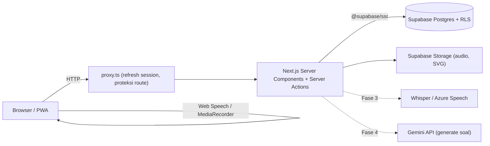
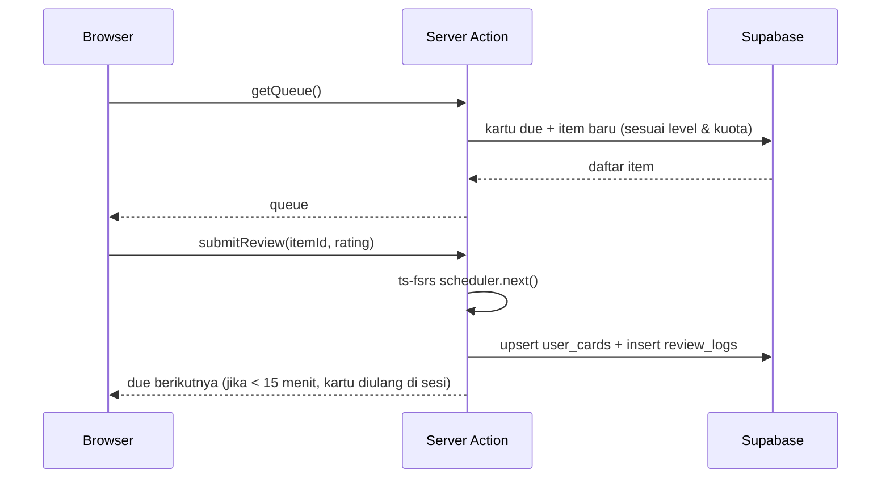

# 🏗️ Arsitektur — JLPT App

## 1. Tech Stack
| Layer | Teknologi |
|---|---|
| Framework | Next.js 16 (App Router, Cache Components, Turbopack) |
| Bahasa | TypeScript |
| Styling | Tailwind CSS 4 |
| Auth + DB + Storage | Supabase (Postgres + RLS) via `@supabase/ssr` |
| SRS | `ts-fsrs` (FSRS v6) |
| Utilitas Jepang | `wanakana` (kana ↔ romaji); rencana: `kuromoji`, `kuroshiro` |
| Deploy | Vercel (frontend) + Supabase (backend) |

## 2. Diagram Sistem


## 3. Struktur Folder & File
Struktur berikut memisahkan kode yang **sudah ada di Fase 1 (`✅`)** dan modul **rencana Fase 2–6 (`⏳`)** yang seluruh layarnya sudah dirancang di `design/jlpt-app.figcraft`, mengikuti konvensi Next.js 16 App Router (`proxy.ts`, Server Components, Server Actions, route groups `(auth)` / `(app)`, dan komponen lokal `_components/`).

```
jlpt-app/
├─ design/
│  └─ jlpt-app.figcraft             # ✅ Desain UI lengkap Light/Dark Mode (Desktop & Mobile)
├─ docs/                            # ✅ Dokumentasi proyek
│  ├─ README.md
│  ├─ PLAN.md                       # Roadmap, estimasi lama belajar & aktivitas tambahan
│  ├─ FEATURES.md                   # Spesifikasi detail 7 fitur inti
│  ├─ ARCHITECTURE.md               # Arsitektur, struktur folder & file (file ini)
│  └─ TOOLS.md                      # Daftar library, sumber data gratis & agent
├─ public/
│  ├─ manifest.json                 # ⏳ Konfigurasi PWA (install di HP)
│  ├─ sw.js                         # ⏳ Service Worker untuk cache aset/audio offline
│  └─ icons/                        # ⏳ Ikon aplikasi PWA (192px, 512px)
├─ scripts/                         # ⏳ Script import data & generate bank soal offline (admin/dev)
│  ├─ import-jmdict.ts              # ⏳ Import kosakata JMdict + mapping level N5–N1
│  ├─ import-kanjidic.ts            # ⏳ Import KANJIDIC2 & urutan goresan KanjiVG
│  ├─ import-tatoeba.ts             # ⏳ Import contoh kalimat Tatoeba
│  └─ generate-questions.ts         # ⏳ Generate soal via Gemini API (sekali jalan) → simpan ke DB
├─ supabase/
│  ├─ migrations/
│  │  ├─ 0001_init.sql              # ✅ Skema awal + RLS + trigger profil otomatis
│  │  ├─ 0002_reading_writing.sql   # ⏳ Tabel bacaan bertingkat, kuis & data stroke KanjiVG
│  │  ├─ 0003_exams_curriculum.sql  # ⏳ Tabel unit/bab kurikulum, simulasi JLPT & hasil per bagian
│  │  └─ 0004_mistakes_notes.sql    # ⏳ Tabel mistake_notebook, misi mingguan & preferensi tema
│  └─ seed.sql                      # ✅ Seed awal (46 hiragana, 25 kosakata N5, 8 kanji N5)
└─ src/
   ├─ proxy.ts                      # ✅ Refresh session Supabase & proteksi route (Next.js 16)
   ├─ types/
   │  └─ database.ts                # ⏳ Tipe tabel Supabase lengkap
   ├─ lib/
   │  ├─ supabase/
   │  │  ├─ client.ts               # ✅ Browser Supabase client
   │  │  └─ server.ts               # ✅ Server Supabase client (cookies)
   │  ├─ srs.ts                     # ✅ Wrapper FSRS (ts-fsrs) untuk jadwal hafalan
   │  ├─ types.ts                   # ✅ Tipe Item, Profile, JLPT_LEVELS
   │  ├─ theme.ts                   # ⏳ Helper Light / Dark / System mode (cookie + class dark)
   │  ├─ japanese/
   │  │  ├─ furigana.ts             # ⏳ Tokenisasi & furigana/romaji otomatis (kuroshiro + kuromoji)
   │  │  ├─ kana-compare.ts         # ⏳ Normalisasi hiragana & skor Levenshtein (pengucapan)
   │  │  └─ stroke-validator.ts     # ⏳ Validasi arah, urutan & kemiripan goresan KanjiVG
   │  └─ audio/
   │     ├─ tts.ts                  # ⏳ Wrapper pemutar audio (VOICEVOX Storage + Web Speech API)
   │     └─ whisper-client.ts       # ⏳ Speech-to-text lokal di browser (@huggingface/transformers)
   ├─ hooks/                        # ⏳ Custom React hooks
   │  ├─ useTheme.ts                # ⏳ Switcher Light/Dark Mode
   │  ├─ useAudioRecorder.ts        # ⏳ Rekam suara via MediaRecorder API
   │  └─ useExamTimer.ts            # ⏳ Countdown timer per bagian simulasi JLPT
   ├─ components/                   # ⏳ Komponen UI bersama (solid style, Washi & Ai-iro Indigo)
   │  ├─ layout/
   │  │  ├─ AppShell.tsx            # ⏳ Sidebar Desktop + Bottom Nav Mobile responsif
   │  │  ├─ ThemeToggle.tsx         # ⏳ Tombol pilih Light / Dark / Sistem
   │  │  └─ ToastProvider.tsx       # ⏳ Notifikasi toast solid ("Tersimpan ke Hafalan", dll.)
   │  ├─ modals/
   │  │  ├─ WordPopup.tsx           # ⏳ Popover Desktop & Bottom Sheet Mobile arti kata
   │  │  ├─ ExamLeaveModal.tsx      # ⏳ Peringatan pindah bagian ujian JLPT ("tidak bisa kembali")
   │  │  └─ SessionDoneModal.tsx    # ⏳ Ringkasan selesai sesi belajar + streak
   │  └─ ui/                        # ⏳ Komponen dasar (Button, Badge, Card, ProgressBar, Tabs)
   └─ app/
      ├─ globals.css                # ✅ Konfigurasi Tailwind CSS 4 + token warna Light/Dark
      ├─ layout.tsx                 # ✅ Root layout, font (Inter + Noto Sans JP) & ThemeProvider
      ├─ page.tsx                   # ✅ Landing page publik
      ├─ login/                     # ✅ Auth Login & Register (Server Actions)
      │  ├─ page.tsx
      │  └─ actions.ts
      ├─ about/                     # ⏳ Halaman Tentang & atribusi lisensi data (JMdict, KanjiVG, dll.)
      │  └─ page.tsx
      ├─ dashboard/                 # ✅ Beranda belajar (target hari ini, statistik, menu latihan)
      │  ├─ page.tsx
      │  └─ actions.ts
      ├─ profile/                   # ⏳ Profil pengguna, target level N5–N1, kuota harian & pilih tema
      │  ├─ page.tsx
      │  └─ actions.ts
      ├─ curriculum/                # ⏳ Peta bab bertahap N5–N1, Boss Quiz, misi mingguan & estimasi
      │  ├─ page.tsx
      │  └─ [unitId]/page.tsx
      ├─ review/                    # ✅ Sesi Hafalan Kartu pintar (FSRS: Lupa/Sulit/Bisa/Mudah)
      │  ├─ page.tsx
      │  ├─ actions.ts
      │  └─ ReviewSession.tsx
      ├─ kana/                      # ✅ Tabel lengkap Hiragana & Katakana + dakuon/youon + audio
      │  └─ page.tsx
      ├─ reading/                   # ⏳ Modul Membaca bertingkat N5–N1 + furigana + popup kata + kuis
      │  ├─ page.tsx
      │  └─ [id]/page.tsx
      ├─ writing/                   # ⏳ Latihan Menulis goresan (Lihat Animasi → Jiplak → Tulis Sendiri)
      │  ├─ page.tsx
      │  └─ StrokeCanvas.tsx
      ├─ pronunciation/             # ⏳ Latihan Ngomong ulang 3–5x, skor ≥ 85% lulus & tips perbaikan
      │  ├─ page.tsx
      │  └─ actions.ts
      ├─ kaiwa/                     # ⏳ Roleplay percakapan situasional (Konbini, Jikoshoukai, Mensetsu)
      │  ├─ page.tsx
      │  └─ [scenario]/page.tsx
      ├─ culture/                   # ⏳ Sisipan budaya & etika kerja Jepang (Hou-Ren-Sou, Ojigi)
      │  └─ page.tsx
      ├─ shadowing/                 # ⏳ Latihan menirukan audio (0.75x–1.0x) & choukai situasional
      │  └─ page.tsx
      ├─ bunpou/                    # ⏳ Bunpou Builder: susun pola kalimat + toggle bentuk sopan/biasa
      │  └─ page.tsx
      ├─ mistakes/                  # ⏳ Buku Catatan Kesalahan (Mistake Notebook) & latihan ulang
      │  ├─ page.tsx
      │  └─ actions.ts
      ├─ daily-test/                # ⏳ Tes Harian otomatis 20 soal (50% SRS / 30% Baru / 20% Audio)
      │  ├─ page.tsx
      │  ├─ actions.ts
      │  └─ result/page.tsx         # ⏳ Skor & rekomendasi setelah Tes Harian
      ├─ exam/                      # ⏳ Simulasi Ujian JLPT N5–N1 berwaktu per bagian
      │  ├─ page.tsx
      │  ├─ [level]/page.tsx        # ⏳ Pengerjaan soal + daftar nomor + tanda Ragu + timer
      │  └─ [level]/result/page.tsx # ⏳ Hasil nilai per bagian, batas lulus & pembahasan soal
      └─ progress/                  # ⏳ Statistik lengkap, streak, grafik mingguan & penguasaan level
         └─ page.tsx
```

> [!NOTE]
> File bertanda `✅` sudah ada di repository saat ini, sedangkan file bertanda `⏳` akan dibuat bertahap sesuai fase di [PLAN.md](./PLAN.md) agar build TypeScript/Next.js tetap bersih tanpa file kosong.

## 4. Skema Database
```mermaid
erDiagram
  AUTH_USERS ||--|| PROFILES : has
  AUTH_USERS ||--o{ USER_CARDS : owns
  ITEMS ||--o{ USER_CARDS : scheduled_as
  AUTH_USERS ||--o{ REVIEW_LOGS : writes
  ITEMS ||--o{ REVIEW_LOGS : about
  AUTH_USERS ||--o{ PRONUNCIATION_ATTEMPTS : records
  ITEMS ||--o{ PRONUNCIATION_ATTEMPTS : for
  AUTH_USERS ||--o{ DAILY_TESTS : takes

  PROFILES { uuid id PK; text target_level; int daily_new_limit }
  ITEMS { bigint id PK; text type; text jlpt_level; text term; text reading; text meaning; jsonb extra }
  USER_CARDS { bigint id PK; uuid user_id; bigint item_id; timestamptz due; float stability; float difficulty; smallint state }
  REVIEW_LOGS { bigint id PK; smallint rating; int scheduled_days; timestamptz reviewed_at }
  PRONUNCIATION_ATTEMPTS { bigint id PK; smallint attempt_no; numeric score; bool passed }
  DAILY_TESTS { bigint id PK; date test_date; jsonb questions; numeric score }
```

- `items.type`: `kana` | `vocab` | `kanji` | `grammar`
- `items.extra` (jsonb): onyomi, kunyomi, jumlah goresan, path SVG KanjiVG, dll.
- Semua tabel milik user dilindungi **RLS** (`auth.uid() = user_id`); `items` hanya bisa dibaca user login.
- Profil dibuat otomatis oleh trigger `on_auth_user_created`.

## 5. Alur Review SRS


## 6. Konvensi
- Akses data hanya lewat **Server Components / Server Actions** (tidak ada secret di client).
- Komponen yang membaca session dibungkus `<Suspense>` (wajib di Cache Components).
- Migrasi SQL baru: `supabase/migrations/000X_nama.sql`, berurutan.
- Env: `NEXT_PUBLIC_SUPABASE_URL`, `NEXT_PUBLIC_SUPABASE_PUBLISHABLE_KEY` di `.env.local`.
- **Bank Soal & Hemat Token**: Pemanggilan Gemini API hanya dilakukan **secara batch oleh admin/developer** lewat `scripts/generate-questions.ts` (atau halaman/CLI admin) lalu disimpan permanen ke Postgres Supabase — **tidak dipanggil *real-time* per pengguna** saat membuka Tes Harian atau Simulasi Ujian.
- **Ikon UI (SVG Only)**: Seluruh ikon navigasi, tombol, tema (Terang/Gelap/Sistem), mikrofon, dan indikator status **wajib menggunakan ikon SVG** (inline SVG / `lucide-react`), **dilarang memakai emoji Unicode** di dalam aplikasi.
