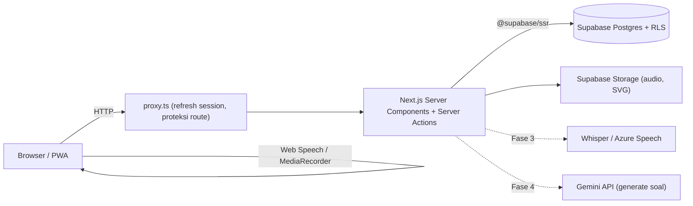
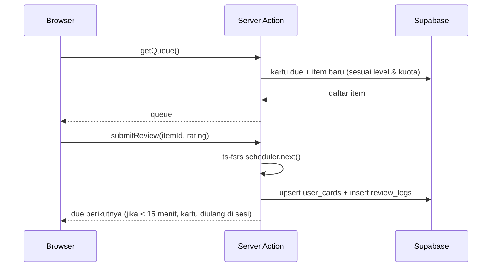

# 🏗️ Arsitektur — JLPT App

## 1. Tech Stack
| Layer | Teknologi |
|---|---|
| Framework | Next.js 16 (App Router, Cache Components, Turbopack) |
| Bahasa | TypeScript |
| Styling | Tailwind CSS 4 |
| Auth + DB + Storage | Supabase (Postgres + RLS) via `@supabase/ssr` |
| SRS | `ts-fsrs` (FSRS v6) |
| Utilitas Jepang | `wanakana` (kana ↔ romaji); rencana: `kuromoji`, `kuroshiro` |
| Deploy | Vercel (frontend) + Supabase (backend) |

## 2. Diagram Sistem


## 3. Struktur Folder
```
jlpt-app/
├─ docs/                       # dokumentasi (file ini)
├─ supabase/
│  ├─ migrations/0001_init.sql # skema + RLS
│  └─ seed.sql                 # data awal
└─ src/
   ├─ proxy.ts                 # session refresh & redirect ke /login
   ├─ lib/
   │  ├─ supabase/client.ts    # client untuk komponen browser
   │  ├─ supabase/server.ts    # client untuk server (cookies)
   │  ├─ srs.ts                # wrapper FSRS (applyReview, mapping row ↔ Card)
   │  └─ types.ts              # tipe Item, Profile, JLPT_LEVELS
   └─ app/
      ├─ page.tsx              # landing
      ├─ login/                # login/daftar (server actions)
      ├─ dashboard/            # statistik + pengaturan level
      ├─ review/               # sesi SRS (getQueue, submitReview)
      └─ kana/                 # tabel kana
```

## 4. Skema Database
```mermaid
erDiagram
  AUTH_USERS ||--|| PROFILES : has
  AUTH_USERS ||--o{ USER_CARDS : owns
  ITEMS ||--o{ USER_CARDS : scheduled_as
  AUTH_USERS ||--o{ REVIEW_LOGS : writes
  ITEMS ||--o{ REVIEW_LOGS : about
  AUTH_USERS ||--o{ PRONUNCIATION_ATTEMPTS : records
  ITEMS ||--o{ PRONUNCIATION_ATTEMPTS : for
  AUTH_USERS ||--o{ DAILY_TESTS : takes

  PROFILES { uuid id PK; text target_level; int daily_new_limit }
  ITEMS { bigint id PK; text type; text jlpt_level; text term; text reading; text meaning; jsonb extra }
  USER_CARDS { bigint id PK; uuid user_id; bigint item_id; timestamptz due; float stability; float difficulty; smallint state }
  REVIEW_LOGS { bigint id PK; smallint rating; int scheduled_days; timestamptz reviewed_at }
  PRONUNCIATION_ATTEMPTS { bigint id PK; smallint attempt_no; numeric score; bool passed }
  DAILY_TESTS { bigint id PK; date test_date; jsonb questions; numeric score }
```

- `items.type`: `kana` | `vocab` | `kanji` | `grammar`
- `items.extra` (jsonb): onyomi, kunyomi, jumlah goresan, path SVG KanjiVG, dll.
- Semua tabel milik user dilindungi **RLS** (`auth.uid() = user_id`); `items` hanya bisa dibaca user login.
- Profil dibuat otomatis oleh trigger `on_auth_user_created`.

## 5. Alur Review SRS


## 6. Konvensi
- Akses data hanya lewat **Server Components / Server Actions** (tidak ada secret di client).
- Komponen yang membaca session dibungkus `<Suspense>` (wajib di Cache Components).
- Migrasi SQL baru: `supabase/migrations/000X_nama.sql`, berurutan.
- Env: `NEXT_PUBLIC_SUPABASE_URL`, `NEXT_PUBLIC_SUPABASE_PUBLISHABLE_KEY` di `.env.local`.
