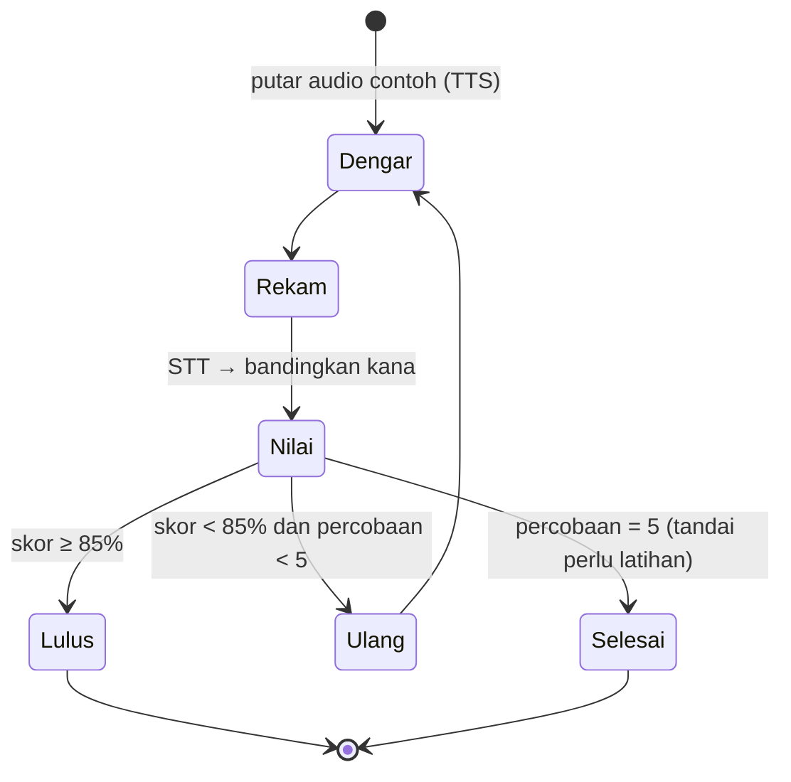

# 🧩 Spesifikasi Fitur

## 1. 🧠 Hafalan (SRS) — *Fase 1, selesai*
- Algoritma **FSRS** (`ts-fsrs`), target retensi 90%, fuzz aktif.
- Rating: **Lupa (1) · Sulit (2) · Bisa (3) · Mudah (4)**.
- Antrian = kartu jatuh tempo + kartu baru (maks. `daily_new_limit` per hari).
- Kartu baru diambil dari level target **dan semua level di bawahnya** (N5 dulu).
- Kartu yang jadwal berikutnya < 15 menit diulang di akhir sesi.

## 2. 📖 Membaca — *Fase 2*
- Teks bertingkat per level (N5: kalimat pendek → N1: artikel/esai).
- Toggle **furigana / romaji / terjemahan** (kuroshiro + kuromoji).
- Klik kata → popup arti (JMdict) + tombol tambah ke SRS.
- Kuis pemahaman pilihan ganda setelah bacaan.

## 3. ✍️ Menulis — *Fase 2*
- Data goresan dari **KanjiVG** (SVG).
- Mode: **Lihat** (animasi) → **Jiplak** (dengan panduan) → **Tanpa panduan**.
- Validasi tiap goresan: urutan, arah, dan kemiripan bentuk.
- Cakupan: hiragana, katakana, kanji N5–N1.

## 4. 🗣️ Pengucapan — *Fase 3*

- **Minimal 3 kali** pengucapan per item, **maksimal 5**.
- Skor = kemiripan (Levenshtein) transkrip vs target, dalam bentuk hiragana.
- Setiap percobaan disimpan di `pronunciation_attempts`.
- Item yang gagal 5x otomatis masuk antrean latihan ulang besok.
- **Rencana Pembaruan Durasi Rekam Adaptif (`useSpeechPractice.ts`)**: durasi otomatis **5 detik** untuk teks pendek (`≤ 12` kana), **10 detik** untuk teks sedang (`13–24` kana), dan **15 detik** untuk teks panjang (`≥ 25` kana / dialog *Kaiwa*), dengan mode `continuous`, **countdown timer & progress bar**, **auto-stop + penilaian otomatis**, serta tombol henti lebih cepat.

## 5. 📅 Daily Test — *Fase 4*
- Dibuat otomatis tiap hari (cron) per user, 1 tes/hari (`daily_tests`).
- Komposisi (default 20 soal):
  | Porsi | Sumber |
  |---|---|
  | 50% | Kartu SRS jatuh tempo / sering salah |
  | 30% | Materi baru level target |
  | 20% | Listening / pengucapan |
- Tipe soal: pilihan ganda, ketik kana, susun kalimat, dengar & pilih.
- Hasil memengaruhi rekomendasi (ulang materi / lanjut).

## 6. 🎓 Ujian JLPT (Simulasi) — *Fase 4*
| Level | Bagian | Waktu (perkiraan) |
|---|---|---|
| N5 | 文字・語彙 · 文法・読解 · 聴解 | ±105 menit |
| N4 | 文字・語彙 · 文法・読解 · 聴解 | ±125 menit |
| N3 | 文字・語彙 · 文法・読解 · 聴解 | ±140 menit |
| N2 | 言語知識・読解 · 聴解 | ±155 menit |
| N1 | 言語知識・読解 · 聴解 | ±165 menit |
- Timer per bagian, tidak bisa kembali ke bagian sebelumnya.
- Skor per bagian + total, dengan batas lulus minimum per bagian (mengikuti aturan JLPT).
- Pembahasan jawaban setelah ujian.

> [!NOTE]
> Waktu ujian di atas perkiraan; sesuaikan dengan ketentuan resmi terbaru di jlpt.jp.

## 7. 📊 Progres — *Fase 6*
- Streak harian, grafik review, akurasi per tipe item.
- Persentase penguasaan per level (N5–N1).
