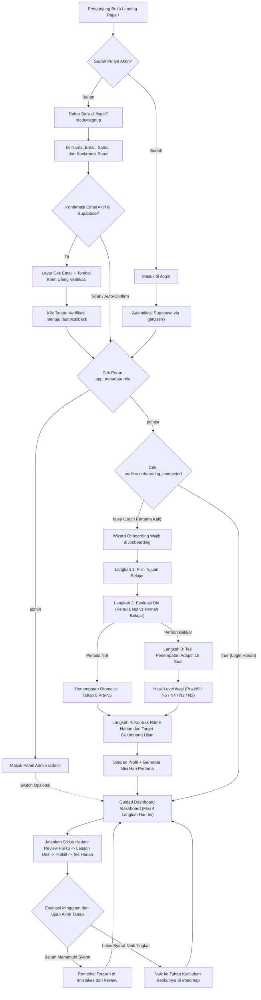
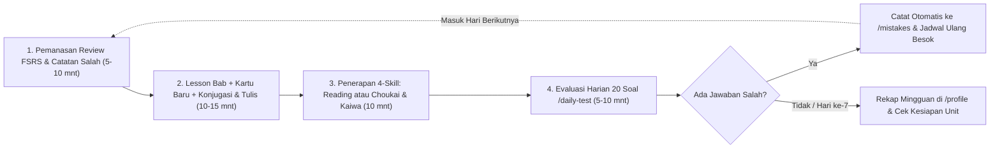

# Rancangan Alur Sistem, Onboarding & Kurikulum Pendidikan Bahasa Jepang — JLPT App

Dokumen ini menjadi acuan tunggal (*single source of truth*) untuk seluruh **alur sistem pengguna sejak registrasi pertama kali, wajib onboarding & tes penempatan, routing login berbasis peran/tahap, aturan pedagogi kelas bahasa Jepang asli, rincian isi materi per bab (Tahap 0–5)**, hingga **peta implementasi teknis** di `jlpt-app`.

## Daftar Isi
1. [Ringkasan Eksekutif & Audit Kondisi Saat Ini](#1-ringkasan-eksekutif--audit-kondisi-saat-ini)
2. [Alur Sistem Detail: Register → Verifikasi → Onboarding → Login → Routing](#2-alur-sistem-detail-register--verifikasi--onboarding--login--routing)
3. [Standar Pelatihan Bahasa Jepang Formal (JF Standard · CEFR · JLPT & 4 Aturan Autentik Kelas)](#3-standar-pelatihan-bahasa-jepang-formal-jf-standard--cefr--jlpt--4-aturan-autentik-kelas)
4. [Rincian Materi yang Dikeluarkan per Tahap & Bab (Silabus Detail Tahap 0 – Tahap 5)](#4-rincian-materi-yang-dikeluarkan-per-tahap--bab-silabus-detail-tahap-0--tahap-5)
5. [Alur Belajar Harian & Mingguan Terarah (*Guided Learning Loop*)](#5-alur-belajar-harian--mingguan-terarah-guided-learning-loop)
6. [Audit Kesenjangan Materi Saat Ini vs Target Pelatihan & Kebijakan Akses](#6-audit-kesenjangan-materi-saat-ini-vs-target-pelatihan--kebijakan-akses)
7. [Spesifikasi Teknis & Peta Implementasi di `jlpt-app`](#7-spesifikasi-teknis--peta-implementasi-di-jlpt-app)
8. [Kepatuhan Hak Cipta, Lisensi Data & Batasan Sertifikasi](#8-kepatuhan-hak-cipta-lisensi-data--batasan-sertifikasi)

---

## 1. Ringkasan Eksekutif & Audit Kondisi Saat Ini

Aplikasi `jlpt-app` sudah memiliki 11+ modul latihan inti (`/review`, `/kana`, `/reading`, `/writing`, `/pronunciation`, `/kaiwa`, `/culture`, `/daily-test`, `/exam/[level]`, `/bunpou`, `/mistakes`), halaman profil & pengaturan (`/profile`, `/settings`), serta Panel Admin (`/admin`) dengan generator soal batch Gemini AI ke tabel `question_bank`.

Hasil audit terhadap kode saat ini (`supabase/migrations/0001_init.sql`, `src/app/login/actions.ts`, `src/proxy.ts`, dan `src/app/dashboard/page.tsx`) menunjukkan **3 celah alur pengalaman pelajar**:

| # | Celah yang Ditemukan Saat Ini | Dampak terhadap Pelajar | Solusi dalam Blueprint Ini |
| :--- | :--- | :--- | :--- |
| **1** | Belum ada fase **Onboarding & Tes Penempatan** setelah daftar/login pertama. Tabel `profiles` (`0001_init.sql`) langsung memakai default `target_level = 'N5'` dan `daily_new_limit = 10`. | Pengguna baru langsung masuk `/dashboard` tanpa penentuan level awal (belum bisa Kana vs sudah pernah belajar N4/N3) dan tanpa rencana waktu belajar. | Tambahkan wizard wajib 4 langkah di `/onboarding` yang dijaga lewat flag `profiles.onboarding_completed`. |
| **2** | Ketidaksinkronan metadata nama pada proses **Signup** di `src/app/login/actions.ts`: `supabase.auth.signUp()` mengirim `options: { data: { full_name: displayName } }`, sedangkan trigger `handle_new_user()` membaca `raw_user_meta_data->>'display_name'`. Bila verifikasi email aktif (`!data.session`), `.update()` manual terblokir RLS sebelum konfirmasi email. | Kolom `display_name` berisiko memakai potongan email alih-alih nama yang diketik user saat daftar. | Kirim `{ display_name: displayName, full_name: displayName }` saat `signUp()` dan perbarui trigger `handle_new_user()` agar memakai `coalesce(display_name, full_name, emailPrefix)`. |
| **3** | Halaman `/dashboard` (`src/app/dashboard/page.tsx`) menampilkan belasan kartu modul secara sejajar tanpa pelajaran pengantar bab, aturan lepas romaji, maupun urutan harian. | Terjadi *choice overload*: pelajar tidak tahu urutan belajar yang benar dan belum mendapat materi pengajaran sebelum latihan soal. | Ubah `/dashboard` menjadi **Kokpit Misi Harian 4 Langkah** sesuai tahap aktif, lengkapi dengan **Halaman Pelajaran Bab (`Lesson`)** dan peta silabus berurutan di `/roadmap`. |

> [!NOTE]
> Arsitektur **Admin & Bank Soal Gemini Hemat Token** di `/admin` (`src/app/admin/page.tsx`, `src/lib/ai/gemini-questions.ts`, `supabase/migrations/0004_admin_question_bank.sql`) tetap berjalan penuh. Pelajar hanya mengonsumsi soal statis dan soal `question_bank` yang disetujui Admin (`approved = true`), sehingga biaya AI per pelajar aktif tetap **0 token**.

---

## 2. Alur Sistem Detail: Register → Verifikasi → Onboarding → Login → Routing

### A. Registrasi Akun Pertama Kali (`/login?mode=signup`)

1. **Validasi Input**:
   - **Nama Lengkap / Panggilan** (wajib, minimal 2 karakter).
   - **Email** (validasi format standar).
   - **Kata Sandi** (minimal 8 karakter direkomendasikan) dan **Konfirmasi Kata Sandi**.
2. **Pembuatan Akun & Trigger Profil**:
   - `signup()` memanggil `supabase.auth.signUp()` dengan `emailRedirectTo: "<origin>/auth/callback?next=/onboarding"` serta metadata `{ display_name, full_name }`.
   - Trigger `public.handle_new_user()` membuat baris `public.profiles` dengan default `onboarding_completed = false`, `current_stage = 'PRE_N5'`, `target_level = 'N5'`, `daily_new_limit = 10`, dan `romaji_enabled = true`.
3. **Dua Jalur Pasca-Daftar**:
   - **Jika Verifikasi Email Aktif (`!data.session`)**: Tampilkan kartu konfirmasi khusus berisi instruksi buka inbox, tombol **Kirim Ulang Email Verifikasi** (cooldown 60 detik), dan opsi ganti email. Saat link email diklik, route handler `/auth/callback` menukar `code` menjadi sesi aktif (`exchangeCodeForSession`) lalu langsung menuju `/onboarding`.
   - **Jika Auto-Confirm Aktif (`data.session` ada)**: Langsung dialihkan ke `/onboarding`.

### B. Wizard Onboarding Wajib Pengguna Baru (`/onboarding`, 3–5 Menit)

| Langkah | Judul & Istilah Jepang | Aksi Pengguna | Pengaturan Sistem |
| :--- | :--- | :--- | :--- |
| **Langkah 1** | **Tujuan Belajar** (`学習目的`) | Memilih jalur utama: **Persiapan Ujian JLPT N5–N1** (`jlpt`), **Kerja / Tokutei Ginou / Magang (SSW & JFT-Basic A2)** (`work_ssw`), **Kuliah / Beasiswa Jepang** (`study_jp`), atau **Komunikasi Harian** (`general`). | Jalur `work_ssw` otomatis memperbesar porsi `/kaiwa` (kerja/konbini/wawancara), `敬語`, dan `/culture` (*Hou-Ren-Sou* & *Ojigi*), sementara jalur `jlpt` memprioritaskan `文字・語彙`, `文法`, `読解`, dan `聴解`. |
| **Langkah 2** | **Skrining Awal** (`自己評価`) | Memilih kondisi sejujurnya: **Pemula Nol** (*belum lancar membaca Hiragana & Katakana*) atau **Sudah Pernah Belajar** (*sudah bisa Kana / punya dasar N5–N3*). | **Pemula Nol** langsung ditetapkan ke **Tahap 0 · Pra-N5** agar tidak kaget menghadapi kanji. **Sudah Pernah Belajar** masuk ke Langkah 3. |
| **Langkah 3** | **Tes Penempatan Adaptif** (`プレースメントテスト`) | Mengerjakan maksimal 15 soal statis bertingkat (**Blok 1 Kana** 3 soal → **Blok 2 N5** 4 soal → **Blok 3 N4** 4 soal → **Blok 4 N3/N2** 4 soal) dengan aturan berhenti cepat (*early-stop*) jika skor blok < 50%. | Menentukan `current_stage` (`PRE_N5`, `N5`, `N4`, `N3`, atau `N2`) beserta rekomendasi unit awal. Pengguna tetap boleh memilih turun tingkat (*opt-down*) bila ingin mengulang fondasi. |
| **Langkah 4** | **Kontrak & Ritme Belajar** (`学習計画`) | Memilih durasi harian: **Ringan** (15 mnt · 5 kartu baru), **Standar Sekolah Bahasa** (30 mnt · 10 kartu baru), atau **Intensif LPK/Ujian** (60 mnt · 20 kartu baru) + target periode ujian resmi JLPT (**Juli**, **Desember**, atau **Tanpa Tanggal**). | Menghitung estimasi minggu menuju target, menetapkan aturan *Romaji* & *Smart Furigana*, menyimpan `onboarding_completed = true`, membuka Unit pertama di `user_unit_progress`, dan mengarahkan ke `/dashboard`. |

### C. Matriks Routing & Penjagaan Akses (`proxy.ts` + `requireShellContext()`)

Seluruh pemeriksaan sesi menggunakan `await supabase.auth.getUser()` agar konsisten antara proxy dan server component tanpa loop redirect:

| Kondisi Akun | `/` | `/login` | `/onboarding` | `/dashboard` & Modul Belajar | `/admin` |
| :--- | :--- | :--- | :--- | :--- | :--- |
| **Belum Login** | Landing Publik | Login / Signup | Redirect → `/login?next=/onboarding` | Redirect → `/login?next=<path>` | Redirect → `/login?next=/admin` |
| **Pelajar · Onboarding Belum Selesai** | Landing *(CTA "Lanjutkan Setup")* | Redirect → `/onboarding` | **Akses Wizard** | **Redirect wajib → `/onboarding`** | Redirect → `/onboarding` |
| **Pelajar · Onboarding Selesai** | Landing *(CTA "Masuk Beranda")* | Redirect → `/dashboard` | Izinkan ulang jika `?retake=1`, selainnya `/dashboard` | **Akses penuh** | Redirect → `/dashboard` |
| **Admin (`role === "admin"`)** | Landing Publik | Redirect → `/admin` | Tidak diwajibkan | **Akses Mode Pelajar + pintasan Admin** | **Akses Panel Admin** |

---

## 3. Standar Pelatihan Bahasa Jepang Formal (JF Standard · CEFR · JLPT & 4 Aturan Autentik Kelas)

Kurikulum disusun mengikuti kerangka **JF Standard for Japanese-Language Education** (*Can-Do* komunikasi setara CEFR Pre-A1 hingga C1), **Standar Resmi JLPT** (cakupan materi + skor lulus total & *sectional pass mark / 基準点*), serta **4 Aturan Autentik Pelatihan Kelas Bahasa Jepang (`日本語学校 / LPK`)** berikut:

### 3.1 Halaman Pelajaran & Penjelasan Bab (`文型説明 / Lesson View`) Sebelum Latihan
Di pelatihan nyata, pengajar selalu menerangkan konsep terlebih dahulu (**`導入` — Pengenalan**) sebelum siswa mengerjakan soal atau hafalan:
- Setiap unit di `/roadmap/[unitCode]` diawali **Kartu Pelajaran Terstruktur** berisi: (1) penjelasan fungsi & arti pola kalimat dalam Bahasa Indonesia yang lugas, (2) perbandingan partikel atau pola yang sering tertukar bagi penutur Indonesia *(mis. `は` vs `が`, `で` vs `に`, `あげる` vs `もらう`)*, (3) tabel aturan perubahan kata (*konjugasi*), (4) audio contoh kalimat, dan (5) catatan etiket budaya terkait.
- Siswa baru masuk ke `/bunpou`, `/writing`, dan `/review` **setelah** membaca ringkasan bab (`"Tandai Paham Materi Bab Ini"`).

### 3.2 Kebijakan Lepas Romaji & Lepas Furigana Bertahap (*Romaji Weaning & Smart Furigana*)
Ketergantungan pada huruf latin (*romaji*) menghambat kecepatan baca huruf Kana/Kanji dan membuat pelajar gagal di ujian resmi (karena ujian JLPT/JFT **tidak pernah** menampilkan romaji). Sistem menerapkan pelepasan bertahap otomatis:

| Tahap Belajar | Pengaturan Default Romaji | Pengaturan Default Furigana (*Cara Baca Kanji*) | Tujuan Pedagogis |
| :--- | :--- | :--- | :--- |
| **Tahap 0 · Pra-N5** | **ON** saat belajar bunyi huruf di Unit 0.1–0.2; **OFF wajib** pada Kuis Gerbang Unit 0.3 | Tidak berlaku *(semua pakai Hiragana/Katakana)* | Memastikan siswa membaca bentuk huruf Kana langsung, bukan membaca tulisan latin. |
| **Tahap 1 · JLPT N5** | **OFF default** *(bisa diintip sementara lewat tombol bantuan darurat)* | **ON** untuk semua Kanji di teks `/reading`, soal, dan contoh kalimat | Siswa terbiasa membaca kalimat full Kana + Kanji berfurigana sejak hari pertama N5. |
| **Tahap 2 · JLPT N4** | **OFF** | **Mode Pintar (*Smart Furigana*)**: Kanji N5 yang sudah dikuasai (`state >= 2` di FSRS) **disembunyikan furigana-nya** (muncul jika kata diketuk) | Melatih pengenalan otomatis Kanji dasar sambil memberi bantuan pada Kanji N4 baru. |
| **Tahap 3–5 · N3–N1** | **OFF** | Hanya muncul pada Kanji baru/belum dikuasai atau saat kata diketuk (*tap-to-peek*) | Menyesuaikan kondisi bacaan asli ujian JLPT N3–N1 dan artikel Jepang nyata. |

### 3.3 Drill Konjugasi (`活用ドリル`) & Kata Bantu Bilangan (`助数詞`)
Dua komponen paling krusial dalam pelatihan kelas Jepang (yang sering menyebabkan kesalahan meskipun siswa hafal arti kosakata) diwajibkan per unit:
- **Drill Konjugasi Kata Kerja & Kata Sifat**:
  - Memisahkan **Golongan 1 (`五段 / u-verb`)**, **Golongan 2 (`一段 / ru-verb`)**, dan **Golongan 3 (`不規則: する・くる`)** plus catatan pengecualian klasik (`帰る`, `入る`, `走る` masuk Golongan 1; `行く → 行って`).
  - Melatih transformasi cepat antar bentuk sesuai progres unit: `ます形` → `て形` → `ない形` → `た形` → `辞書形` (N5), lalu `可能形`・`意向形`・`命令/禁止`・`受身`・`使役` (N4).
  - Melatih perubahan kata sifat `-い` vs `-な` untuk bentuk negatif, lampau, dan bentuk sambung (`〜くて` vs `〜で`).
- **Drill Kata Bantu Bilangan (*Counters / 助数詞*) & Perubahan Bunyi**:
  - Melatih pasangan objek dan satuan hitung yang benar: benda umum (`〜つ`), orang (`ひとり・ふたり・さんにん`), benda pipih (`〜枚`), benda panjang (`いっぽん・にほん・さんぼん`), buku (`〜冊`), mesin/kendaraan (`〜台`), hewan kecil (`〜匹`), lantai (`〜階`), jam/menit (`〜時・〜分`), dan kalender (`ついたち・ふつか...`).

### 3.4 Pelatihan Mendengar Resmi 4 Tipe JLPT (`聴解 / Choukai`) + Shadowing & Dikte
Latihan mendengarkan tidak cukup sekadar memutar satu kata. Pelatihan dibagi menjadi:
1. **Format 4 Sub-Tes Resmi JLPT** *(dengan audio TTS `ja-JP` kecepatan normal + penanda jeda percakapan)*:
   - *Tipe 1 · Pemahaman Tugas (`課題理解`)*: Apa yang harus dilakukan pembicara setelah percakapan selesai?
   - *Tipe 2 · Poin Kunci (`ポイント理解`)*: Menangkap detail spesifik (waktu, harga, alasan) dari pengumuman/dialog.
   - *Tipe 3 · Respons Cepat (`即時応答`)*: Mendengar 1 kalimat pendek lalu memilih balasan paling alami dalam hitungan detik (sangat penting untuk komunikasi LPK/SSW).
   - *Tipe 4 · Gambaran Umum (`概要理解`, mulai N3–N1)*: Menentukan topik utama atau opini penutur dari monolog/berita.
2. **Shadowing Bertahap (`0.75x → 0.85x → 1.0x`)** di `/pronunciation` & `/kaiwa`.
3. **Dikte Pendek (`書き取り`)**: Mendengar kata/frasa lalu mengetik dalam Kana (untuk menguji ketepatan `っ` ganda, `ん`, dan vokal panjang `う・い`).
4. **Rombak Perekaman Suara Adaptif Berbasis Panjang Teks (`5 dtk` vs `10–15 dtk`) & Peningkatan Akurasi Transkrip**:
   - **Teks Pendek** (`≤ 12` karakter kana, mis. kata tunggal atau salam singkat): durasi rekam **5 detik**.
   - **Teks Sedang** (`13–24` karakter kana, mis. 1 kalimat pendek): durasi rekam **10 detik**.
   - **Teks Panjang** (`≥ 25` karakter kana, mis. kalimat lengkap / dialog *Kaiwa*): durasi rekam **15 detik**.
   - **Spesifikasi Hook & UI (`src/hooks/useSpeechPractice.ts`, `/pronunciation`, `/kaiwa`)**: ubah `continuous = true` agar pengenalan suara tidak terputus prematur saat jeda napas singkat, pisahkan secara tegas segmen `isFinal` vs `interim` (mencegah duplikasi/sisa potongan kata), tampilkan **countdown timer & progress bar** (`5 dtk` / `10 dtk` / `15 dtk`), **auto-stop + penilaian otomatis** saat waktu habis, serta tombol **Stop & Nilai Lebih Cepat** bila pelajar selesai berbicara sebelum batas waktu.
   - **Kebijakan Anti-Noise & Best-of-5 Matching (`useSpeechPractice.ts` & `src/lib/japanese/kana-compare.ts`)**:
     - Aktifkan `rec.maxAlternatives = 5` dan evaluasi **seluruh alternatif** dari Web Speech API untuk mengambil kandidat yang paling mendekati bacaan target (*Best-of-N Matching*), bukan hanya `results[i][0]`.
     - Aktifkan `echoCancellation: true`, `noiseSuppression: true`, dan `autoGainControl: true` pada `getUserMedia`, serta otomatis jalankan `window.speechSynthesis.cancel()` + jeda `250ms` sebelum `rec.start()` agar pantulan audio contoh TTS tidak ikut masuk ke mikrofon.
     - Perluas konversi Kanji → Hiragana pada evaluator dan terapkan toleransi vokal ekor / *filler* mikro pada frasa sangat pendek *(mis. `じゃ` yang sering ditranskrip otomatis oleh model bahasa Google `ja-JP` menjadi `じゃあ`)* — **kecuali** pada latihan kontras vokal panjang (*chouon* seperti `おばさん` vs `おばあさん`) yang tetap dinilai ketat.

### 3.5 Mekanisme Review Kartu FSRS 2-Tahap (*Verified Active Recall + Think Pause*)
Untuk mencegah ***illusion of competence*** (pelajar langsung membuka kartu dan menekan *Mudah/Bisa* secara refleks tanpa benar-benar memanggil ingatan), setiap kartu pada `/review` wajib berjalan dalam **2 tahap terpisah**:

1. **Tahap 1 — Uji Ingatan & Jeda Anti-Klik (`Think Pause 1,5 detik`)**:
   - Saat kartu muncul, **ke-4 tombol rating FSRS (`Lupa / Sulit / Bisa / Mudah`) belum ditampilkan**.
   - Pelajar melihat istilah Jepang (patuh kebijakan *Romaji Weaning*) + timer tenang berjalan naik (`00:02`, `00:05`) + **4 tombol pilihan cepat** *(arti atau bacaan Kana, diacak dari level yang sama)* untuk membuktikan ingatan terlebih dahulu.
   - Tombol sekunder **"Tidak Tahu / Buka Jawaban"** memiliki **jeda kunci mikro `1,5 detik`** sejak kartu tampil agar tidak terpencet tidak sengaja oleh *double-tap* / *Spasi* refleks.
   - Pelajar tingkat lanjut (`N3–N1`) dapat mengaktifkan toggle **Mode Kartu Cepat (*Pure Recall / Anki*)** di header `/review` atau `/settings` (tanpa opsi A–D, tetap mempertahankan jeda `1,5 detik` sebelum buka jawaban).
2. **Tahap 2 — Hasil Tervalidasi & Penilaian FSRS Terkunci Jujur**:
   - Setelah memilih salah satu opsi (atau klik *"Tidak Tahu"*), kartu terbuka menampilkan bacaan Kana, arti, contoh kalimat, dan memutar audio penutur otomatis, lalu memunculkan 4 tombol FSRS:
     - **Jika Pilihan SALAH atau klik *"Tidak Tahu"***: Tombol **`Bisa` (3)** dan **`Mudah` (4)** **otomatis dinonaktifkan** (hanya `Lupa` yang disorot utama, opsi maksimal `Sulit` bila sekadar salah ketuk), serta kartu otomatis dicatat ke `/mistakes` agar dijadwalkan remedial.
     - **Jika Pilihan BENAR**: Ke-4 tombol aktif dengan **sorotan rekomendasi otomatis berdasarkan kecepatan respons** (`< 3 dtk` → sarankan *Mudah*, `3–8 dtk` → *Bisa*, `> 8 dtk` → *Sulit*), sambil tetap memberi kendali akhir kepada pelajar untuk menilai tingkat keyakinannya secara jujur.

---

## 4. Rincian Materi yang Dikeluarkan per Tahap & Bab (Silabus Detail Tahap 0 – Tahap 5)

### Peta Induk 6 Tahap Kurikulum & Syarat Naik Tingkat (`進級基準`)

| Tahap & Level | Setara JF / CEFR | Estimasi Jam Belajar (Non-Kanji)* | Target Kuantitatif Formal | Kompetensi *Can-Do* Utama | Syarat Lulus / Naik Tingkat (`進級基準`) |
| :--- | :--- | :--- | :--- | :--- | :--- |
| **Tahap 0 · Pra-N5** *(入門・文字基礎)* | Pre-A1 | **25–40 jam** *(± 2–4 minggu)* | 46 Hiragana + 46 Katakana + 58 Dakuon/Youon + Sokuon/Chouon + angka & salam dasar | Membaca & menulis 92+ aksara Kana tanpa romaji; membedakan bunyi panjang/ganda. | Akurasi Tes Kana (tanpa romaji) ≥ **85%**, ≥ **80%** Kana selesai di `/writing`, & lulus Kuis Gerbang Tahap 0. |
| **Tahap 1 · JLPT N5** *(初級前半)* | A1 | **300–450 jam** *(± 4–6 bulan @ 2 jam/hari)* | ~800 kosakata · 110 kanji · ~65 pola bunpou · 8 unit tematik (setara Bab 1–25 *Minna no Nihongo*) | Memperkenalkan diri, berbelanja, beraktivitas harian, menyebut lokasi, meminta izin/permohonan dasar. | Selesai ≥ **75%** unit Tahap 1 + lulus `/exam/n5` (Total ≥ **80/180**; Pengetahuan Bahasa & Bacaan ≥ **38/120**; Listening ≥ **19/60**). |
| **Tahap 2 · JLPT N4** *(初級後半 · Setara JFT-Basic A2)* | A2 | **600–800 jam kumulatif** *(+ 5–7 bulan)* | ~1.500 kosakata · ~300 kanji · ~130 pola bunpou · 6 unit tematik (setara Bab 26–50 *Minna no Nihongo*) | Menjelaskan alasan, memberi/menerima jasa, bentuk potensial/syarat/pasif-kausatif, serta *Keigo* & etika kerja (*SSW*). | Selesai ≥ **75%** unit Tahap 2 + lulus `/exam/n4` (Total ≥ **90/180**; Pengetahuan Bahasa & Bacaan ≥ **38/120**; Listening ≥ **19/60**). |
| **Tahap 3 · JLPT N3** *(中級前半)* | B1 | **1.100–1.500 jam kumulatif** *(+ 8–10 bulan)* | ~3.750 kosakata · ~650 kanji · ~200 pola bunpou · 5 unit tematik | Memahami artikel berita pendek, ragam lisan kasual vs formal, serta menyampaikan alasan & pendapat terstruktur. | Selesai ≥ **75%** unit Tahap 3 + lulus `/exam/n3` (Total ≥ **95/180**; tiap 3 bagian ≥ **19/60**). |
| **Tahap 4 · JLPT N2** *(中級後半)* | B2 | **1.900–2.400 jam kumulatif** *(+ 12–15 bulan)* | ~6.000 kosakata · ~1.000 kanji · ~300 pola bunpou · 4 unit tematik | Membaca koran, instruksi kerja, & opini; memahami *Keigo* bisnis dan siaran berkecepatan alami. | Selesai ≥ **75%** unit Tahap 4 + lulus `/exam/n2` (Total ≥ **90/180**; tiap 3 bagian ≥ **19/60**). |
| **Tahap 5 · JLPT N1** *(上級)* | C1 | **3.000+ jam kumulatif** *(+ 18–24 bulan)* | ~10.000 kosakata · ~2.000+ Joyo Kanji · ~400+ ekspresi lanjut · 4 unit | Memahami teks akademis, editorial kritis, argumen tersirat, & ungkapan formal/sastra tingkat tinggi. | Selesai ≥ **75%** unit Tahap 5 + lulus `/exam/n1` (Total ≥ **100/180**; tiap 3 bagian ≥ **19/60**). |

> *Catatan jam belajar mengacu pada estimasi pembelajar non-kanji di [PLAN.md](./PLAN.md#6-estimasi-lama-belajar-catatan--acuan-pacing).*

---

### Rincian Unit Tahap 0 · Pra-N5 (Aksara, Bunyi & Fondasi Kelas)

| Unit | Aksara & Materi Inti | Latihan Bunyi, Tulis & Kuis | Target Lulus Unit |
| :--- | :--- | :--- | :--- |
| **Unit 0.1** *Hiragana Dasar* | 46 huruf dasar (`あ〜お` s.d. `わ・を・ん`), tata cara penulisan kotak seimbang, partikel dasar pembacaan `は (wa)` & `を (o)`, angka `0–10`, salam pagi–malam. | `/kana` (suara + bentuk), `/writing` (urutan goresan dasar), dikte tebak huruf, antrean awal `/review`. | Akurasi baca & tulis 46 Hiragana ≥ **85%** tanpa romaji. |
| **Unit 0.2** *Modifikasi Bunyi & Pelafalan* | 20 *Dakuon* (`がざだば`), 5 *Handakuon* (`ぱぴぷぺぽ`), 33 *Youon* (`きゃ・しゅ・ちょ`), *Sokuon* (`っ` mis. `きって` vs `きて`), *Chouon* (vokal panjang mis. `おばあさん` vs `おばさん`), angka `11–100`. | Drill pasangan kontras audio (`chouon` & `sokuon`), pengucapan 3–5x `/pronunciation` (skor ≥ 85%), dikte pendek. | Bisa membedakan panjang-pendek vokal & konsonan ganda saat mendengar audio. |
| **Unit 0.3** *Katakana & Gerbang Pra-N5* | 46 Katakana dasar (`ア〜ン`) + Dakuon/Youon/vokal panjang `ー` (`コーヒー`, `テーブル`, `コンビニ`, `インドネシア`), nama negara & kata serapan kerja/harian. | `/kana` (Katakana), `/writing` Katakana inti, **Kuis Gerbang Tahap 0** (gabungan baca Hiragana + Katakana + angka). | Nilai **Kuis Gerbang Kana ≥ 85%** → sistem mematikan romaji default dan membuka Unit 1.1. |

---

### Rincian Unit Tahap 1 · JLPT N5 Penuh (8 Unit · Setara Bab 1–25 *Minna no Nihongo*)

Total sasaran Tahap 1: **~800 kosakata, 110 Kanji N5 spesifik, ~65 pola tata bahasa, 8 skenario Kaiwa, dan 8–16 teks bacaan.**

| Unit & Tema | Kosakata & Bilangan (~800 Kata) | Daftar Kanji Spesifik Unit (110 Kanji N5) | Pola Tata Bahasa (`文法`) & Drill Konjugasi | Latihan 4-Skill (`Reading · Speaking · Kaiwa · Culture`) |
| :--- | :--- | :--- | :--- | :--- |
| **Unit 1.1 (`自己紹介`)** *Identitas, Negara & Bilangan Dasar* | Kata ganti orang (`私・あなた`), profesi (`学生・会社員・実習生・先生`), nama negara, angka `1–99.999` & usia (`〜歳`). *(Target: ~80 kata)* | **14 Kanji**: `一 二 三 四 五 六 七 八 九 十 百 千 万 円` | `N1 は N2 です / じゃありません`, kalimat tanya `〜か`, partikel `の・も`, kata bantu umur `いっさい・はたち`. | **Reading**: Kartu profil singkat. **Kaiwa**: Perkenalan diri pertama kali (*Jikoshoukai*). **Culture**: Sudut membungkuk *Ojigi* (`15° / 30° / 45°`) & `Aisatsu`. |
| **Unit 1.2 (`買い物・時間`)** *Benda, Harga, Jam & Tanggal* | Penunjuk benda & tempat, nama benda harian, nama hari (`月〜日`), bulan, jam & menit, serta angka harga. *(Target: +100 → 180 kata)* | **14 Kanji**: `日 月 火 水 木 金 土 曜 年 時 分 半 午 何` | `これ・それ・あれ` & `この・その・あの`, `ここ・そこ・あそこ`, partikel waktu `に`, rentang `から〜まで`, bacaan menit (`いっぷん・ごふん`) & tanggal (`ついたち〜じゅうよっか`). | **Reading**: Papan jam buka toko & struk harga. **Kaiwa**: Belanja & pesan hangat di *Konbini*. **Listening**: Tipe 2 menangkap jam & harga. |
| **Unit 1.3 (`毎日の生活`)** *Aktivitas Harian & Kata Kerja Sopan* | Kata kerja harian (`起きます・寝ます・働きます・行きます・食べます・飲みます`), makanan/minuman, keterangan waktu & alat transportasi. *(Target: +110 → 290 kata)* | **14 Kanji**: `今 週 毎 先 来 行 帰 食 飲 見 聞 読 書 話` | Konjugasi dasar bentuk `ます / ません / ました / ませんでした`, partikel lokasi aktivitas `で`, objek `を`, arah `へ`, alat/bahasa `で`, ajakan `〜ませんか / 〜ましょう`. | **Reading**: Jadwal kegiatan harian pelajar. **Pronunciation**: Partikel `は` vs `を` & pengucapan lampau `〜ました`. **Kaiwa**: Mengajak teman makan siang / pulang bersama. |
| **Unit 1.4 (`家族・形容詞`)** *Keluarga, Sifat & Perbandingan* | Anggota keluarga sendiri vs orang lain (`父・お父さん`), kata sifat `-い` (`大きい・高い・忙しい`) & `-な` (`静か・便利・元気`), warna & hobi. *(Target: +100 → 390 kata)* | **14 Kanji**: `人 名 友 男 女 父 母 子 生 学 校 本 語 言` | Kalimat sifat `-い` & `-な` (positif, negatif `〜くない / 〜じゃない`, lampau `〜かった / 〜でした`), kata tanya `どんな・どう`, penguat `とても / あまり〜ません`, `そして / でも`. | **Reading**: Surat singkat tentang keluarga & kampung halaman. **Bunpou**: Drill mengubah sifat positif ↔ negatif lampau. **Culture**: Etika menyebut keluarga sendiri vs keluarga orang lain. |
| **Unit 1.5 (`存在・場所・数`)** *Keberadaan, Arah & Kata Bantu Bilangan* | Kata posisi (`上・下・前・後ろ・中・外・隣`), ruangan rumah/kantor, fasilitas umum, dan kata benda terhitung. *(Target: +100 → 490 kata)* | **14 Kanji**: `大 小 高 安 新 古 長 多 少 白 目 口 耳 手` | Perbedaan `あります` (benda mati) vs `います` (makhluk hidup), pola lokasi `[Tempat] に [Benda] が あります`, `A や B など`, **Drill Kata Bantu Bilangan** (`〜つ`, `〜人`, `〜枚`, `〜本`, `〜台`). | **Reading**: Denah kantor / kamar asrama. **Kaiwa**: Menanyakan letak barang & lokasi di stasiun/toko. **Listening**: Tipe 1 memilih posisi benda yang tepat. |
| **Unit 1.6 (`て形・依頼と規則`)** *Perubahan Bentuk `て`, Permohonan & Aturan* | Kata kerja lanjutan (menyalakan/mematikan alat, memakai pakaian, bekerja, membantu), aturan tempat kerja & asrama. *(Target: +110 → 600 kata)* | **14 Kanji**: `上 下 中 外 前 後 右 左 東 西 南 北 間 足` | **Drill Inti Klasifikasi Kata Kerja (Gol 1, 2, 3) → Bentuk `て`**: `〜てください`, `〜ています` (sedang berlangsung & status), `〜てもいいですか`, `〜てはいけません`, sambung aksi `〜て、〜て`, sambung sifat `〜くて / 〜で`. | **Reading**: Poster tata tertib asrama/pabrik. **Pronunciation**: Kontras `きって` vs `きて` pada bentuk `て`. **Kaiwa**: Meminta izin & minta tolong ke rekan/atasan (*onegaishimasu*). |
| **Unit 1.7 (`ない・辞書・た形`)** *Larangan, Kemampuan, Pengalaman & Ragam Biasa* | Kata kerja pengalaman & aktivitas luar ruangan, kata keterangan frekuensi (`いつも・時々・まだ`), ekspresi opini dasar. *(Target: +110 → 710 kata)* | **13 Kanji**: `出 入 立 会 休 買 歩 走 待 持 切 押 教` | **Drill Konjugasi Lengkap N5 (`ない形・辞書形・た形・普通形`)**: `〜ないでください`, `〜なければなりません`, `〜なくてもいいです`, `〜ことができます`, `〜たことがあります`, `〜たり〜たりします`, `〜と思います / 〜と言いました`. | **Reading**: Catatan harian pengalaman akhir pekan di Jepang. **Bunpou**: Toggle bentuk sopan (*Teineikei*) ↔ kasual (*Futsukei*). **Kaiwa**: Berdiskusi santai dengan teman tentang hobi & rencana liburan. |
| **Unit 1.8 (`総復習・模擬試験`)** *Integrasi, Pembersihan Kesalahan & Simulasi Ujian N5* | Kosakata pengayaan gabungan N5 (cuaca, tubuh/sakit, surat/transportasi, kata penghubung). *(Target: +90 → ~800 kata)* | **13 Kanji**: `山 川 天 気 雨 空 花 電 車 駅 社 店 国` | Review seluruh partikel (`は・が・を・に・で・へ・と・から・まで・も`), modifikasi kata benda oleh anak kalimat (`[Kalimat biasa] + Kata Benda`), `〜時` & `〜まえに`, review `/mistakes`. | **Reading**: Bacaan gabungan N5 lengkap (dengan timer). **Listening**: Latihan 4 sub-tes Choukai N5. **Evaluasi Wajib**: `/exam/n5` (lulus total ≥ 80/180 & per bagian). |

---

### Rincian Unit Tahap 2 · JLPT N4 Penuh (6 Unit · Setara Bab 26–50 *Minna no Nihongo* & *JFT-Basic A2 / SSW*)

Total sasaran Tahap 2: **~1.500 kosakata kumulatif (+700 baru), ~300 Kanji (+190 baru), ~130 pola bunpou (+65 baru), serta kesiapan JFT-Basic A2 & budaya kerja Jepang.**

| Unit & Tema | Tambahan Kosakata & Kelompok Kanji (~190 Kanji N4) | Pola Tata Bahasa (`文法`) & Konjugasi Inti | Fokus 4-Skill & Jalur Kerja / SSW |
| :--- | :--- | :--- | :--- |
| **Unit 2.1 (`理由・可能`)** *Penjelasan Alasan, Kemampuan & Situasi* | +120 kosakata kerja/harian. **~32 Kanji**: `仕事・働く・会社・工場・病院・医者・薬・銀行・郵便局・道・町・村・建物・屋・室・場` | `〜んです / 〜んですが`, **Bentuk Potensial (`可能形`)** & `見えます・聞こえます`, `〜しか〜ません`, `〜ながら`, `〜し、〜し`, `〜てみます`. | **Kaiwa**: Konsultasi ringan di klinik/bank & mengajukan kendala dengan `〜んですが`. **Smart Furigana**: Kanji N5 mulai disembunyikan otomatis. |
| **Unit 2.2 (`計画・準備`)** *Kehendak, Persiapan & Kondisi Hasil* | +120 kosakata jadwal, aturan kerja & barang. **~32 Kanji**: `予定・計画・準備・始・終・開・閉・届・決・集・使・送・便・写・真・紙` | **Bentuk Ajakan/Kehendak (`意向形`)**, `〜ようと思っています`, `〜つもりです`, `〜ておきます` (persiapan), `〜てあります` (keadaan hasil aksi), `〜てしまいます` (selesai/penyesalan). | **Reading**: Memo prosedur kerja & panduan persiapan rapat/lembur. **Listening**: Tipe 1 (Tugas yang harus diselesaikan dulu). |
| **Unit 2.3 (`比較・条件`)** *Kalimat Syarat & Prediksi* | +120 kosakata petunjuk jalan, cuaca, & kerusakan mesin. **~32 Kanji**: `度・倍・重・軽・広・狭・太・細・近・遠・早・遅・試・験・答・問` | **4 Bentuk Syarat (`と・ば・たら・なら`)** dan beda pemakaiannya, `〜ようにする / 〜ようになる`, `〜かもしれません`, `〜でしょう / 〜はずです`. | **Reading**: Manual penggunaan alat & pengumuman perubahan jadwal kereta. **Bunpou**: Drill memilih `と / ば / たら / なら` sesuai konteks alami. |
| **Unit 2.4 (`授受・親切`)** *Memberi & Menerima Bantuan (`授受動詞`)* | +120 kosakata relasi sosial, hadiah & pertolongan. **~32 Kanji**: `貸・借・返・教・習・知・思・考・覚・忘・助・守・祝・礼・品・物` | `あげる・もらう・くれる` (benda) dan **pola jasa** `〜てあげる・〜てもらう・〜てくれる`, `〜ていただけませんか` (meminta bantuan dengan sangat sopan). | **Kaiwa**: Berterima kasih & memohon bantuan senior/rekan kerja dengan tepat arah penerima (`くれる` vs `もらう`). |
| **Unit 2.5 (`受身・使役`)** *Kalimat Pasif, Kausatif & Izin Formal* | +110 kosakata instruksi, keluhan & aturan industri. **~30 Kanji**: `注・意・禁・止・危・険・事・故・直・変・通・転・運・動・産・業` | **Bentuk Pasif (`受身形`)** termasuk pasif merugikan, **Bentuk Kausatif (`使役形`: menyuruh/mengizinkan)**, **Kausatif-Pasif (`使役受身`: terpaksa melakukan)**, `〜てほしい`, `〜のに`. | **Reading**: Artikel singkat keselamatan kerja & insiden ringan. **Listening**: Tipe 3 memilih respons cepat saat diberi instruksi atau ditegur sopan. |
| **Unit 2.6 (`敬語・N4模擬`)** *Keigo Dasar (`尊敬語・謙譲語`), Hou-Ren-Sou & Ujian N4* | +110 kosakata bisnis/wawancara & review total. **~32 Kanji**: `様・方・客・員・長・部・係・連・絡・報・告・相・談・礼・失・拝` | Kata kerja spesial **Sonkeigo** (`いらっしゃる・おっしゃる・召し上がる・ご覧になる`) & **Kenjougo** (`参る・申す・いただく・拝見する`), pola `お〜になる` vs `お〜する`, review `/mistakes`. | **Kaiwa**: Wawancara kerja (*Mensetsu*) & laporan *Hou-Ren-Sou* ke manajer. **Culture**: Etika kerja lengkap Jepang. **Evaluasi Wajib**: `/exam/n4` (Total ≥ 90/180; per bagian memenuhi syarat). |

---

### Rincian Tahap 3 – Tahap 5 (Menengah hingga Mahir: N3, N2, N1)

| Tahap & Level | Pembagian Unit Tematik | Materi Inti yang Dikeluarkan | Fokus Latihan di `jlpt-app` |
| :--- | :--- | :--- | :--- |
| **Tahap 3 · JLPT N3** *(5 Unit · B1)* | **3.1** Bahasa lisan kasual & singkatan (`〜ちゃう・〜てる・〜なきゃ`) **3.2** Sebab-akibat & tujuan (`ために・せいで・おかげで`) **3.3** Dugaan, kutipan & perspektif (`らしい・ようだ・っぽい・について・にとって`) **3.4** Wacana berita pendek & opini sehari-hari **3.5** Review & Simulasi `/exam/n3` | **+2.250 kosakata** (→ ~3.750) · **+350 kanji** (→ ~650) · **~70 bunpou baru** (→ ~200). | `/reading` artikel sedang + kuis inferensi; `/bunpou` kontras makna pola mirip; Listening Tipe 4 (*概要理解*); pengurangan furigana lebih agresif. |
| **Tahap 4 · JLPT N2** *(4 Unit · B2)* | **4.1** Ekspresi tulis & laporan formal (`〜にあたって・〜をめぐって・〜に伴って`) **4.2** Nuansa penutur & pembatasan (`〜わけにはいかない・〜ざるを得ない・〜ものの`) **4.3** Bacaan opini panjang, surat bisnis, & iklan/perbandingan info **4.4** Review & Simulasi `/exam/n2` | **+2.250 kosakata** (→ ~6.000) · **+350 kanji** (→ ~1.000) · **~100 bunpou baru** (→ ~300). | Skimming & scanning teks cepat di `/reading`; *Keigo* bisnis & telepon kerja; simulasi `/exam/n2` dengan manajemen waktu ketat (`言語知識・読解` 105 mnt, `聴解` 50 mnt). |
| **Tahap 5 · JLPT N1** *(4 Unit · C1)* | **5.1** Tata bahasa akademis & sastra (`〜といえども・〜を禁じ得ない・〜極まる`) **5.2** Hubungan argumen kompleks & negasi ganda **5.3** Esai abstrak, kritik budaya/sosial & bacaan komparatif (2 teks berbeda pandangan) **5.4** Review & Simulasi `/exam/n1` | **+4.000 kosakata** (→ ~10.000) · **+1.000+ Joyo Kanji** (→ ~2.000+) · **~100+ ekspresi lanjut**. | Analisis argumen tersirat pada `/reading` N1; pembersihan intensif `/mistakes`; simulasi `/exam/n1` penuh. |

---

## 5. Alur Belajar Harian & Mingguan Terarah (*Guided Learning Loop*)

Layar utama `/dashboard` menampilkan **Kokpit Misi Hari Ini (`今日の学習ミッション`)** yang memandu pelajar melewati 4 langkah berurutan setiap hari agar proses belajar konsisten dan tidak melompat-lompat.

### Detail Siklus Harian di `/dashboard`

1. **Langkah 1 — Pemanasan & Retensi Memori (`復習 · Retrieval Practice`, 5–10 menit)**
   - Selesaikan seluruh kartu jatuh tempo (`dueCount`) di `/review` (*ts-fsrs*), lalu bersihkan maksimal 3–5 item di `/mistakes`.
   - **Mengapa selalu didahulukan**: Menguji memori lama sebelum masuk materi baru mencegah penumpukan lupa (*FSRS backlog*) dan menjaga target retensi 90%.
2. **Langkah 2 — Pelajaran Bab, Kartu Baru & Drill Dasar (`導入・基本練習`, 10–15 menit)**
   - **Wajib buka ringkasan bab (`/roadmap/[unitCode]`)** jika pelajar baru masuk unit baru (atau saat lupa aturan bab).
   - **Tahap 0**: Pelajari huruf baru unit aktif di `/kana` + tulis goresan di `/writing` (mode bertahap **Lihat animasi → Jiplak panduan → Tulis tanpa panduan**) + kunci di `/review`.
   - **Tahap 1–5**: Pelajari kuota kartu baru hari ini (`daily_new_limit` dari kosakata & kanji unit aktif), lakukan drill konjugasi/kata bantu bilangan + susun kalimat di `/bunpou`, lalu tulis 2–3 kanji unit aktif di `/writing` (**Lihat → Jiplak → Tanpa panduan**).
3. **Langkah 3 — Penerapan Kontekstual 4 Keterampilan (`運用・4技能`, 10 menit · Rotasi Harian)**
   - **Hari Ganjil (`Reading & Dikte`)**: Baca 1 teks sesuai unit di `/reading` (tanpa romaji; gunakan *Smart Furigana* sesuai tahap), ketuk kosakata asing untuk simpan ke `/review`, lalu jawab kuis bacaan.
   - **Hari Genap (`Choukai, Pronunciation, Kaiwa & Culture`)**: Latih pelafalan 3–5x di `/pronunciation` (lulus ≥ 85%), mainkan 1 skenario `/kaiwa`, selesaikan 2–3 soal *Choukai* (Tipe 1–3), dan baca 1 kartu `/culture` *(porsi Kaiwa & Culture otomatis lebih sering untuk jalur `work_ssw`)*.
4. **Langkah 4 — Evaluasi Harian (`確認テスト`, 5–10 menit)**
   - Kerjakan `/daily-test` 20 soal (**50% SRS jatuh tempo**, **30% materi baru unit aktif**, **20% audio mendengarkan**). Jawaban salah otomatis masuk `mistakes_notebook` untuk diulang besok di Langkah 1.

### Siklus Mingguan & Ujian Kenaikan Tahap

- **Evaluasi Mingguan (Hari ke-7)**: Halaman `/profile` menghitung akurasi 7 hari terakhir per komponen JLPT (`文字・語彙`, `文法`, `読解`, `聴解`, & `発音`), menandai komponen terlemah, dan memberi misi remedial otomatis minggu berikutnya.
- **Ujian Kenaikan Tahap (`進級模擬試験`)**: Ketika ≥ 75% unit suatu tahap selesai, kokpit mengarahkan pelajar ke `/exam/[level]` sesuai standar skor total & batas minimum per bagian (*sectional pass mark*). Bila belum memenuhi salah satu bagian, sistem tetap mempertahankan tahap saat ini dan menjadwalkan latihan terfokus di bagian yang kurang.

---

## 6. Audit Kesenjangan Materi Saat Ini vs Target Pelatihan & Kebijakan Akses

### Audit Jujur Isi Materi di Codebase Sekarang

Berikut perbandingan langsung antara isi data aktual di repository saat ini dengan kebutuhan riil agar pelatihan dapat dijalankan secara penuh:

| Komponen Materi | Lokasi Data Saat Ini | Isi Aktual Sekarang | Target Pelatihan Penuh (Minimal Siap Pakai N5 + N4) | Status & Tindak Lanjut |
| :--- | :--- | :--- | :--- | :--- |
| **Pelajaran Bab (`Lesson`)** | *Belum tersedia* | **0 bab** | **17 bab terstruktur** (3 Pra-N5 + 8 N5 + 6 N4) | Perlu dibuat skema & konten ringkas Bahasa Indonesia per bab. |
| **Aksara Kana (SRS)** | `seed.sql` + `0002_reading_writing.sql` | **92 karakter** (46 Hiragana + 46 Katakana dasar) | 92 dasar + 58 Dakuon/Youon + pasangan latih Sokuon/Chouon | Dakuon/Youon sudah tampil di `/kana`, perlu didaftarkan sebagai unit Tahap 0 + dikte bunyi. |
| **Menulis Goresan** | `src/lib/japanese/kanjivg-strokes.ts` | **36 karakter** | 92 Kana lengkap + 110 Kanji N5 (+ bertahap N4) | Perlu melengkapi data path KanjiVG untuk Kana & Kanji N5. |
| **Kosakata (SRS)** | `supabase/seed.sql` | **25 kata N5** *(N4–N1: 0)* | ~800 kata N5 (8 unit) + ~700 kata N4 (6 unit) | Perlu pengisian terkurasi per `unit_code` (N5 dulu lalu N4; N3–N1 via import JMdict). |
| **Kanji (SRS)** | `supabase/seed.sql` | **8 kanji N5** *(N4–N1: 0)* | 110 Kanji N5 + ~190 Kanji N4 | Perlu diimpor dari daftar 110 Kanji N5 di Bagian 4 lengkap dengan *onyomi/kunyomi* & contoh kata. |
| **Tata Bahasa & Konjugasi** | `src/lib/japanese/bunpou-data.ts` | **6 latihan susun kalimat** *(0 `grammar` di DB)* | ~65 pola N5 + ~65 pola N4 + Drill Konjugasi & Kata Bantu Bilangan | Perlu modul drill konjugasi (`ます/て/ない/た/辞書/可能/受身/使役`) + bank soal per unit. |
| **Bacaan + Furigana** | `src/lib/japanese/reading-data.ts` | **8 teks** (total untuk N5–N1) | 8–16 teks N5 + 6–12 teks N4 (selaras kosakata tiap unit) | Perlu ditambahkan bertahap per unit dan dihubungkan dengan *Smart Furigana*. |
| **Pelafalan (3–5x)** | `src/lib/japanese/pronunciation-data.ts` | **10 frasa** | 5–8 frasa kunci per unit (termasuk kontras bunyi panjang/ganda) | Perlu ditambah sesuai unit Pra-N5, N5, dan N4. |
| **Kaiwa Roleplay** | `src/lib/japanese/kaiwa-data.ts` | **5 skenario** | 8 skenario N5 + 6–8 skenario N4/SSW (1 per unit) | Fondasi dialog sudah baik; perlu dilengkapi per tema bab. |
| **Budaya & Etika Kerja** | `src/lib/japanese/culture-data.ts` | **5 kartu** (*Hou-Ren-Sou, Ojigi, Aisatsu*, dll.) | 8–12 kartu (tambah etika transportasi, izin/lembur, *Keigo*, tempat tinggal) | Sangat dekat dengan target; tinggal tambah variasi etika harian/SSW. |
| **Bank Soal Simulasi Ujian** | `exam-bank.ts` + `/admin` (`question_bank`) | **29 soal statis** (lintas N5–N1) | 40–60 soal per level (mencakup 4 tipe Choukai) | Infrastruktur generator batch **Gemini AI** di `/admin` sudah siap memperbanyak soal secara instan tanpa beban token user. |

### Prioritas Pengisian Materi yang Paling Efektif (Bertahap & Realistis)

Agar aplikasi cepat bisa dipakai pelatihan sungguhan secara autentik tanpa menunggu ribuan kata N1 terisi sekaligus:
1. **Gelombang 1 — Fondasi Nyata Siap Pakai (Pra-N5 + JLPT N5 Penuh)**: Lengkapi penuh Unit `0.1–0.3` dan `1.1–1.8` (~800 kosakata N5, 110 Kanji N5 + KanjiVG, ~65 pola + *Lesson* + drill konjugasi/counter, 8–16 bacaan, 8 kaiwa, dan 40+ soal `/exam/n5` via `/admin` Gemini).
2. **Gelombang 2 — Jalur Kerja & JFT-Basic A2 (JLPT N4 Penuh)**: Lengkapi Unit `2.1–2.6` (~700 kosakata N4 tambahan, ~190 Kanji N4, konjugasi lanjutan + *Keigo*, skenario SSW & etika kerja).
3. **Gelombang 3 — Menengah & Lanjut (N3–N1)**: Jalankan import massal dataset terbuka berlisensi (`JMdict`, `KANJIDIC2`, `Tatoeba` dengan atribusi lisensi) dipadukan dengan kurasi soal ujian di `/admin`.

### Kebijakan Akses (*Soft Gate*) & Sinkronisasi Admin (`/admin`)

- **Soft Gate Terarah**: Kokpit `/dashboard` dan `/roadmap` memandu ketat urutan bab dan misi hari ini, sementara 11 modul tetap dapat diakses lewat menu *"Perpustakaan Latihan Mandiri"*. Jika pelajar membuka level di atas tahap aktifnya (mis. pelajar Tahap 0 membuka `/reading` N3), tampil banner pengingat edukatif tanpa memblokir paksa *(dan mudah diubah menjadi Hard Gate lewat 1 flag konfigurasi jika kelak dipakai kelas/LPK formal)*.
- **Hemat Token AI (0 Token per Pelajar)**: Semua soal tambahan untuk `/exam/[level]`, `/daily-test`, dan tes gerbang unit tetap dibuat & disetujui terlebih dahulu oleh Admin di `/admin` → disimpan ke `question_bank` → dipakai berulang oleh semua pelajar.

---

## 7. Spesifikasi Teknis & Peta Implementasi di `jlpt-app`

### Skema Database Tambahan (`supabase/migrations/0005_onboarding_curriculum.sql`)

1. **Perluasan Tabel `public.profiles`**:
   - `onboarding_completed boolean not null default false`
   - `learning_goal text not null default 'jlpt' check (learning_goal in ('jlpt','work_ssw','study_jp','general'))`
   - `current_stage text not null default 'PRE_N5' check (current_stage in ('PRE_N5','N5','N4','N3','N2','N1'))`
   - `study_minutes_daily smallint not null default 30 check (study_minutes_daily in (15, 30, 60))`
   - `exam_target_period text` *(mis. `'2027-07'`, `'2027-12'`, atau `null`)*
   - `placement_score jsonb not null default '{}'::jsonb`
   - `romaji_enabled boolean not null default true` *(otomatis `false` setelah lulus Tahap 0 atau ditempatkan >= N5)*
   - `furigana_mode text not null default 'all' check (furigana_mode in ('all','smart','off'))`
   - Perbarui trigger `public.handle_new_user()` agar membaca `coalesce(new.raw_user_meta_data->>'display_name', new.raw_user_meta_data->>'full_name', split_part(new.email, '@', 1))`.
2. **Penambahan Kolom Pengikat Unit pada `public.items`**:
   - `unit_code text` + index `items_unit_code_idx (jlpt_level, unit_code, sort_order)` agar setiap kartu kosakata, kanji, dan grammar dapat ditarik akurat sesuai unit yang sedang dipelajari.
3. **Tabel Baru Kurikulum, Pelajaran Bab & Misi Harian (dengan RLS milik user)**:
   - `public.curriculum_units`: definisi bab (`id`, `stage`, `unit_code`, `title_ja`, `title_id`, `can_do_id`, `lesson_summary_md`, `romaji_default`, `sort_order`, `required_accuracy`).
   - `public.user_unit_progress`: progres pelajar per bab (`user_id`, `unit_code`, `lesson_read`, `status` [`'locked' | 'active' | 'completed'`], `accuracy`, `completed_at`).
   - `public.daily_mission_logs`: pencatatan 4 langkah misi harian (`user_id`, `mission_date`, `step_review_done`, `step_input_done`, `step_skill_done`, `step_test_done`, `skill_mode` [`'reading' | 'speaking'`], `completed_at`).

### Peta Implementasi Bertahap

| Fase | Tujuan Teknis | File Utama yang Dibuat / Diubah |
| :--- | :--- | :--- |
| **Fase A · Auth, Callback & Guard Onboarding** | Sinkronkan metadata nama saat signup, tambah `/auth/callback` untuk verifikasi email, buat migrasi `0005_onboarding_curriculum.sql`, dan aktifkan redirect guard `onboarding_completed` di `proxy.ts` + `requireShellContext()`. | `supabase/migrations/0005_onboarding_curriculum.sql` *(baru)*, `src/app/auth/callback/route.ts` *(baru)*, `src/app/login/actions.ts`, `src/app/login/page.tsx`, `src/proxy.ts`, `src/lib/auth-profile.ts`, `src/lib/types.ts` |
| **Fase B · Wizard Onboarding & Placement Test** | Bangun halaman 4 langkah `/onboarding` + bank 15 soal tes penempatan adaptif (`PRE_N5`–`N2`, 0 token AI) + kalkulator kontrak belajar & inisialisasi `user_unit_progress`, `romaji_enabled`, `furigana_mode`. | `src/app/onboarding/page.tsx` *(baru)*, `src/app/onboarding/OnboardingWizard.tsx` *(baru)*, `src/app/onboarding/actions.ts` *(baru)*, `src/lib/japanese/placement-test.ts` *(baru)* |
| **Fase C · Guided Dashboard, Peta Kurikulum & Lesson View** | Ubah `src/app/dashboard/page.tsx` menjadi **Kokpit Misi Harian 4 Langkah** + progres unit aktif; bangun `/roadmap` berisi peta Tahap 0–5 & `/roadmap/[unitCode]` (*Lesson View* aturan kelas formal), serta *Soft Gate Banner* + kebijakan *Romaji Weaning & Smart Furigana*. | `src/lib/japanese/curriculum-roadmap.ts` *(baru)*, `src/app/roadmap/page.tsx` *(baru)*, `src/app/roadmap/[unitCode]/page.tsx` *(baru)*, `src/app/dashboard/page.tsx`, `src/components/layout/AppShell.tsx` |
| **Fase D · Drill Konjugasi/Counter, Choukai, Rekam Suara Adaptif & Laporan Kesiapan** | Tambahkan mode **Drill Konjugasi (`活用`) & Kata Bantu Bilangan (`助数詞`)**, dukungan 4 tipe soal **Choukai**, serta **perombakan perekaman suara adaptif `5 / 10 / 15 detik`** (`continuous = true`, countdown progress bar, auto-stop & early-stop evaluasi); hubungkan seluruh sesi latihan ke `daily_mission_logs` & `user_unit_progress`; tampilkan rekap kesiapan 4 bidang JLPT di `/profile`. | `src/lib/mission-tracker.ts` *(baru)*, `src/hooks/useSpeechPractice.ts`, `src/app/pronunciation/PronunciationWorkspace.tsx`, `src/app/kaiwa/KaiwaWorkspace.tsx`, perluasan `src/app/bunpou/`, `src/app/exam/`, `src/app/daily-test/`, dan `src/app/profile/page.tsx` |
| **Fase E · Pengisian Konten Penuh Gelombang 1, 2 & Halaman Atribusi** | Lengkapi materi nyata Tahap 0 (Kana + Dakuon/Youon lengkap) dan Tahap 1 N5 Penuh (8 unit: ~800 kata, 110 kanji + KanjiVG, ~65 grammar, bacaan, kaiwa, & soal ujian via `/admin`), disusul Tahap 2 N4 (6 unit), serta bangun halaman `/about` berisi atribusi lisensi data terbuka. | `supabase/migrations/0006_seed_pre_n5_and_n5.sql` *(baru)*, `src/lib/japanese/*-data.ts`, `src/app/about/page.tsx` *(baru)*, serta bank soal approved via `/admin` |

---

## 8. Kepatuhan Hak Cipta, Lisensi Data & Batasan Sertifikasi

Untuk menjaga kepatuhan terhadap seluruh ketentuan pada [PLAN.md](./PLAN.md#8-catatan-penting), [FEATURES.md](./FEATURES.md), [TOOLS.md](./TOOLS.md#2-sumber-data-gratis), dan [ARCHITECTURE.md](./ARCHITECTURE.md#6-konvensi), pengembangan dan publikasi materi wajib mematuhi 4 aturan berikut:

### A. Hak Cipta Soal Resmi & Buku Teks Komersial
> [!WARNING]
> Dilarang menyalin soal resmi ujian JLPT (milik Japan Foundation / JEES), soal resmi JFT-Basic, maupun teks/dialog/soal dari buku komersial berhak cipta (*Minna no Nihongo*, *Irodori*, *Tobira*, *Shin Kanzen Master*, dll.).

- Penyebutan nama buku ajar di dokumen ini semata-mata dipakai sebagai **pembanding urutan kompetensi pedagogis formal**.
- Seluruh soal latihan, soal penempatan, kalimat contoh, wacana `/reading`, dan skenario `/kaiwa` di dalam aplikasi **wajib 100% orisinal** (disusun sendiri atau hasil kurasi/review Admin di `/admin` sebelum masuk DB) atau diambil dari dataset terbuka yang mengizinkan pemakaian ulang sesuai lisensinya.

### B. Batasan Status Sertifikasi & Acuan Resmi (`jlpt.jp`)
- Kelulusan unit, kenaikan tahap di `/roadmap`, skor `/daily-test`, maupun hasil `/exam/[level]` merupakan **evaluasi kesiapan internal (*mock readiness*)** dan **bukan sertifikat resmi JLPT (Japan Foundation / JEES) maupun JFT-Basic**. Aplikasi ini tidak berafiliasi dengan penyelenggara ujian resmi tersebut.
- Estimasi durasi simulasi ujian (`N5 ±105 mnt`, `N4 ±125 mnt`, `N3 ±140 mnt`, `N2 ±155 mnt`, `N1 ±165 mnt`) serta ambang skor total & per bagian mengacu perkiraan simulasi dan wajib disesuaikan apabila ada pembaruan ketentuan resmi terbaru di `https://www.jlpt.jp/`.

### C. Atribusi Lisensi Sumber Data Terbuka (Wajib Tampil di Halaman `/about`)

| Sumber Data | Kegunaan | Lisensi | Kewajiban Kepatuhan |
| :--- | :--- | :--- | :--- |
| **JMdict / EDRDG** | Kamus kosakata & arti kata | **CC BY-SA 4.0** | Cantumkan atribusi EDRDG + tautan lisensi di `/about`; turunan data kamus mengikuti lisensi *ShareAlike*. |
| **KANJIDIC2 / EDRDG** | Informasi kanji, bacaan, jumlah goresan | **CC BY-SA 4.0** | Cantumkan atribusi EDRDG + tautan lisensi di `/about`; turunan mengikuti lisensi *ShareAlike*. |
| **KanjiVG** | Data path SVG & urutan goresan menulis | **CC BY-SA 3.0** | Cantumkan atribusi Ulrich Apel / KanjiVG di `/about` dan sumber UI menulis; turunan SVG mengikuti *ShareAlike*. |
| **Tatoeba** | Korpus kalimat contoh kontekstual | **CC BY 2.0 FR** | Cantumkan atribusi proyek Tatoeba & penulis kalimat terkait bila digunakan di `/about`. |
| **VOICEVOX** *(opsional)* | Pra-generate audio pengucapan offline | **Syarat tiap karakter suara** | Cek dan cantumkan kredit nama karakter suara VOICEVOX yang dipakai sebelum merilis audio pra-generate. |

### D. Kepatuhan Arsitektur & Desain UI Internal ([ARCHITECTURE.md](./ARCHITECTURE.md#6-konvensi))
- **Hemat Token AI**: Pemanggilan Gemini API hanya boleh dilakukan secara batch oleh Admin (`/admin` → `question_bank`), tidak pernah dipanggil langsung oleh akun pelajar saat latihan.
- **Keamanan & Cache Components Next.js 16**: Seluruh akses database menggunakan Server Components / Server Actions yang dilindungi Supabase RLS (`auth.uid() = user_id`), dengan komponen sesi dibungkus `<Suspense>`.
- **Ikon UI (SVG Only)**: Seluruh elemen UI dan navigasi di `src/` wajib memakai ikon SVG; **dilarang menggunakan emoji Unicode** di dalam kode aplikasi.
