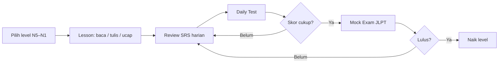

# 🗺️ Project Plan — JLPT App

## 1. Visi
Aplikasi web (PWA) untuk belajar bahasa Jepang dari **N5 sampai N1** secara lengkap:
membaca, menulis, mengucapkan, menghafal, daily test, dan simulasi ujian JLPT —
dengan biaya infrastruktur **gratis** (free tier).

## 2. Target Pengguna
- Pemula yang belum bisa kana (mulai dari N5)
- Pelajar yang menyiapkan ujian JLPT level tertentu
- Bahasa antarmuka: **Bahasa Indonesia**

## 3. Fitur Utama
| # | Fitur | Ringkasan |
|---|---|---|
| 1 | 📖 Membaca | Teks bertingkat N5–N1, furigana/romaji bisa di-toggle, kuis pemahaman |
| 2 | ✍️ Menulis | Animasi urutan goresan + latihan menulis di canvas dengan pengecekan goresan |
| 3 | 🗣️ Pengucapan | Dengar contoh (TTS) → rekam → dinilai → **ulang 3–5x** sampai lulus |
| 4 | 🧠 Hafalan | Flashcard dengan algoritma **FSRS** (kosakata, kanji, kana, grammar) |
| 5 | 📅 Daily Test | Tes harian otomatis sesuai level user (SRS jatuh tempo + soal baru) |
| 6 | 🎓 Ujian JLPT | Simulasi lengkap per level: 文字・語彙, 文法, 読解, 聴解 + timer + skor |
| 7 | 📊 Progres | Statistik, streak, riwayat, rekomendasi naik level |

Detail spesifikasi: lihat [FEATURES.md](./FEATURES.md).

## 4. Alur Belajar

## 5. Roadmap

### ✅ Fase 1 — Fondasi (SELESAI)
- [x] Setup Next.js 16 + TypeScript + Tailwind 4
- [x] Integrasi Supabase (auth email/password, proxy session refresh)
- [x] Skema database + RLS (`supabase/migrations/0001_init.sql`)
- [x] Profil: level target & kuota kartu baru per hari
- [x] SRS dengan ts-fsrs (review Lupa/Sulit/Bisa/Mudah)
- [x] Tabel kana (hiragana + katakana)
- [x] Seed: 46 hiragana, 25 kosakata N5, 8 kanji N5
- [x] TTS dasar (Web Speech API, ja-JP)

### ⏳ Fase 2 — Menulis & Membaca
- [ ] Import data **KanjiVG** (SVG stroke order) ke `items.extra` / storage
- [ ] Komponen animasi urutan goresan
- [ ] Mode latihan menulis (canvas) + validasi arah & urutan goresan
- [ ] Integrasi **kuromoji + kuroshiro** untuk furigana/romaji otomatis
- [ ] Modul bacaan bertingkat + kuis pemahaman
- [ ] Katakana masuk ke SRS

### ⏳ Fase 3 — Pengucapan
- [ ] TTS berkualitas (VOICEVOX / audio pra-generate di Supabase Storage)
- [ ] Rekam suara (MediaRecorder API)
- [ ] Speech-to-text: Web Speech API (cepat) → **Whisper** (akurat)
- [ ] Skor: kemiripan kana (Levenshtein) antara transkrip & target
- [ ] Logika pengulangan **3–5x**, lulus jika skor ≥ 85%
- [ ] Simpan ke `pronunciation_attempts`
- [ ] (Opsional) Azure Pronunciation Assessment untuk skor detail

### ⏳ Fase 4 — Daily Test & Ujian JLPT
- [ ] Generator daily test (Supabase `pg_cron` / Vercel Cron)
- [ ] Tipe soal: pilihan ganda, isi kana, susun kalimat, listening
- [ ] Simulasi ujian per level dengan timer & bagian sesuai format JLPT
- [ ] Penilaian per bagian + passing score
- [ ] Bank soal orisinal (dibuat dengan Gemini API, direview manual)

### ⏳ Fase 5 — Konten Lengkap N5–N1
- [ ] Script import **JMdict** (kosakata) + **KANJIDIC2** (kanji)
- [ ] Contoh kalimat dari **Tatoeba**
- [ ] Mapping level JLPT per kosakata/kanji
- [ ] Terjemahan arti ke Bahasa Indonesia
- [ ] Materi grammar N5–N1

### ⏳ Fase 6 — Polish & Rilis
- [ ] PWA (install di HP, offline cache)
- [ ] Streak, notifikasi pengingat, gamifikasi
- [ ] Dark mode, responsif penuh
- [ ] Deploy Vercel + domain

## 6. Catatan Penting
> [!WARNING]
> Soal resmi JLPT memiliki **hak cipta**. Gunakan soal orisinal buatan sendiri / AI yang sudah direview.

> [!NOTE]
> Perhatikan lisensi data: JMdict & KANJIDIC2 (CC BY-SA 4.0, EDRDG), KanjiVG (CC BY-SA 3.0),
> Tatoeba (CC BY 2.0 FR). Cantumkan atribusi di halaman "Tentang".
