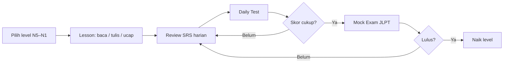

# 🗺️ Project Plan — JLPT App

## 1. Visi
Aplikasi web (PWA) untuk belajar bahasa Jepang dari **N5 sampai N1** secara lengkap:
membaca, menulis, mengucapkan, menghafal, daily test, dan simulasi ujian JLPT —
dengan biaya infrastruktur **gratis** (free tier).

## 2. Target Pengguna
- Pemula yang belum bisa kana (mulai dari N5)
- Pelajar yang menyiapkan ujian JLPT level tertentu
- Bahasa antarmuka: **Bahasa Indonesia**

## 3. Fitur Utama
| # | Fitur | Ringkasan |
|---|---|---|
| 1 | 📖 Membaca | Teks bertingkat N5–N1, furigana/romaji bisa di-toggle, kuis pemahaman |
| 2 | ✍️ Menulis | Animasi urutan goresan + latihan menulis di canvas dengan pengecekan goresan |
| 3 | 🗣️ Pengucapan | Dengar contoh (TTS) → rekam → dinilai → **ulang 3–5x** sampai lulus |
| 4 | 🧠 Hafalan | Flashcard dengan algoritma **FSRS** (kosakata, kanji, kana, grammar) |
| 5 | 📅 Daily Test | Tes harian otomatis sesuai level user (SRS jatuh tempo + soal baru) |
| 6 | 🎓 Ujian JLPT | Simulasi lengkap per level: 文字・語彙, 文法, 読解, 聴解 + timer + skor |
| 7 | 📊 Progres | Statistik, streak, riwayat, rekomendasi naik level |

Detail spesifikasi: lihat [FEATURES.md](./FEATURES.md).

## 4. Alur Belajar

## 5. Roadmap

### ✅ Fase 1 — Fondasi (SELESAI)
- [x] Setup Next.js 16 + TypeScript + Tailwind 4
- [x] Integrasi Supabase (auth email/password, proxy session refresh)
- [x] Skema database + RLS (`supabase/migrations/0001_init.sql`)
- [x] Profil: level target & kuota kartu baru per hari
- [x] SRS dengan ts-fsrs (review Lupa/Sulit/Bisa/Mudah)
- [x] Tabel kana (hiragana + katakana)
- [x] Seed: 46 hiragana, 25 kosakata N5, 8 kanji N5
- [x] TTS dasar (Web Speech API, ja-JP)

### ✅ Fase 2 — Menulis & Membaca (SELESAI - Fondasi & Kurikulum Inti)
- [x] Migrasi skema bacaan, progres menulis & Katakana SRS (`supabase/migrations/0002_reading_writing.sql`)
- [x] Komponen animasi urutan goresan KanjiVG (20 kanji N5, 10 hiragana, 5 katakana inti)
- [x] Mode latihan menulis (kanvas SVG pointer) + validasi arah, titik awal & urutan goresan
- [x] Furigana (`<ruby>`) & romaji (`wanakana`) bertingkat N5–N1 dengan toggle + popup arti kata + simpan ke FSRS
- [x] Modul bacaan bertingkat N5–N1 + audio + kuis pemahaman
- [x] Katakana dasar (46 karakter) masuk ke bank item SRS (`0002_reading_writing.sql`)

### ✅ Fase 3 — Pengucapan, Kaiwa Roleplay & Budaya Jepang (SELESAI - Web Speech & MediaRecorder)
- [x] TTS & kontrol kecepatan (`0.75x / 0.85x / 1.0x`) + mode shadowing lambat (`0.75x`)
- [x] Rekam suara (`MediaRecorder API`) dengan pemutaran balik rekaman pengguna
- [x] Speech-to-text real-time (`Web Speech API ja-JP`) + input fallback manual
- [x] Skor: kemiripan kana (Levenshtein + normalisasi kanji STT umum) (`kana-compare.ts`)
- [x] Logika pengulangan **3–5x**, lulus jika skor ≥ 85%, gagal ke-5 masuk antrean besok FSRS
- [x] Simpan ke `pronunciation_attempts` (`src/app/pronunciation/actions.ts`)
- [x] Roleplay situasional `/kaiwa` & etika budaya kerja `/culture` (Hou-Ren-Sou, Ojigi, Aisatsu)
- [ ] (Opsional/Pengayaan Audio Offline) Audio pra-generate VOICEVOX / Whisper ONNX & Azure Pronunciation Assessment

### ✅ Fase 4 — Daily Test, Ujian JLPT, Bunpou & Catatan Salah (SELESAI - Inti)
- [x] Generator Daily Test 20 soal deterministik harian (`50% SRS / 30% Baru / 20% Audio`) & simpan ke `daily_tests`
- [x] Tipe soal: pilihan ganda, susun kalimat (*chip builder* / Bunpou Builder), dan mendengarkan audio (`ja-JP`)
- [x] Simulasi ujian JLPT N5–N1 berwaktu per bagian, peta nomor, tanda Ragu, serta modal konfirmasi kunci bagian
- [x] Penilaian per bagian (skala 180) + batas lulus minimum per bagian + pembahasan lengkap
- [x] Buku Catatan Kesalahan otomatis (`mistakes_notebook`) & migrasi `0003_exams_mistakes.sql`
- [ ] (Tahap 5 / Batch Admin) Script batch `scripts/generate-questions.ts` (Gemini API sekali jalan) + Cron otomatis harian

### ⏳ Fase 5 — Konten Lengkap N5–N1
- [ ] Script import **JMdict** (kosakata) + **KANJIDIC2** (kanji)
- [ ] Contoh kalimat dari **Tatoeba**
- [ ] Mapping level JLPT per kosakata/kanji
- [ ] Terjemahan arti ke Bahasa Indonesia
- [ ] Materi grammar N5–N1

### ⏳ Fase 6 — Polish & Rilis
- [ ] PWA (install di HP, offline cache)
- [ ] Streak, notifikasi pengingat, gamifikasi
- [ ] Dark mode, responsif penuh
- [ ] Deploy Vercel + domain

## 6. Estimasi Lama Belajar (Catatan & Acuan Pacing)
Untuk pembelajar non-kanji (seperti pelajar SMK, mahasiswa, atau pemula di Indonesia), penguasaan setiap level JLPT membutuhkan **jam belajar aktif** yang cukup panjang. Estimasi ini dijadikan acuan agar materi di aplikasi disusun bertahap dan tidak terkesan "selesai dalam sekejap":

| Level | Fokus Materi | Jam Belajar Tambahan | Estimasi Mandiri (~2 jam/hari) | Estimasi Kelas Intensif (~4–5 jam/hari) |
|---|---|---|---|---|
| **N5** | Hiragana, Katakana, ~100 kanji, ~800 kosakata | **300 – 600 jam** | **± 5 – 10 bulan** *(150–300 hari)* | **± 2,5 – 4 bulan** |
| **N4** | ~300 kanji, ~1.500 kosakata, tata bahasa harian | **+300 – 400 jam** | **± 5 – 7 bulan lagi** | **± 2,5 – 3 bulan lagi** |
| **N3** | ~600–650 kanji, ~3.700 kosakata, jembatan menengah | **+500 – 700 jam** | **± 8 – 12 bulan lagi** | **± 4 – 5,5 bulan lagi** |
| **N2** | ~1.000 kanji, ~6.000 kosakata, bacaan berita/kerja | **+800 – 900 jam** | **± 12 – 15 bulan lagi** | **± 6 – 7,5 bulan lagi** |
| **N1** | ~2.000 kanji, ~10.000+ kosakata, teks kompleks | **+1.000 – 2.000 jam** | **± 1,5 – 2,5 tahun lagi** | **± 8 – 14 bulan lagi** |

> [!TIP]
> Aplikasi mengatur ritme belajar melalui **kuota kartu baru harian**, **antrean ulang SRS jangka panjang**, dan **target mingguan per bab** supaya pengguna konsisten 30–60 menit/hari tanpa kewalahan atau cepat bosan.

## 7. Aktivitas Pembelajaran Tambahan (Biar Pelatihan Lebih Terasa Nyata & Menarik)
Di luar latihan baca, tulis, pengucapan, flashcard, dan ujian, kelas/pelatihan bahasa Jepang umumnya juga menyisipkan aktivitas berikut agar proses belajar berasa seperti kursus terstruktur dan seru:

| # | Aktivitas Tambahan | Tujuan & Manfaat bagi Pengguna |
|---|---|---|
| 1 | 🎭 **Kaiwa / Roleplay Percakapan Situasional** | Simulasi dialog pendek dunia nyata (*jikoshoukai*/perkenalan, belanja di konbini, pesan makan, tanya arah, wawancara kerja/magang *mensetsu*). |
| 2 | 🎧 **Shadowing & Choukai Kontekstual** | Menirukan audio penutur asli secara langsung (kecepatan 0.75x → 1.0x) dan memahami pengumuman stasiun, telepon, atau percakapan pendek. |
| 3 | 🧩 **Latihan Pola Kalimat (*Bunpou Builder*)** | Merangkai kalimat dari pola tata bahasa tertentu (misal partikel, bentuk *~te*, *~tai*, hingga ragam sopan *keigo*) agar tidak sekadar hafal kata lepas. |
| 4 | 🏯 **Sisipan Budaya & Etika Jepang (*Bunka & Manner*)** | Kartu singkat budaya kerja & kehidupan di Jepang: *aisatsu* (salam), aturan *ojigi* (membungkuk), *hou-ren-sou* (lapor-komunikasi-konsultasi), serta kebiasaan harian. |
| 5 | 🏆 **Peta Bab Bertahap & Misi Mingguan** | Materi dibagi per unit/bab layaknya kurikulum buku (*Bab 1: Salam → Bab 2: Angka & Waktu...*) lengkap dengan *Boss Quiz* per bab dan lencana pencapaian (*badges*). |
| 6 | 📓 **Buku Catatan Kesalahan (*Mistake Notebook*)** | Kumpulan otomatis kosakata/kanji/partikel yang sering salah saat latihan agar mudah diulas ulang sebelum ujian. |

## 8. Catatan Penting
> [!WARNING]
> Soal resmi JLPT memiliki **hak cipta**. Gunakan soal orisinal buatan sendiri / AI yang sudah direview.

> [!NOTE]
> Perhatikan lisensi data: JMdict & KANJIDIC2 (CC BY-SA 4.0, EDRDG), KanjiVG (CC BY-SA 3.0),
> Tatoeba (CC BY 2.0 FR). Cantumkan atribusi di halaman "Tentang".
